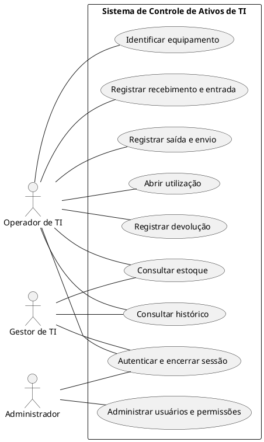
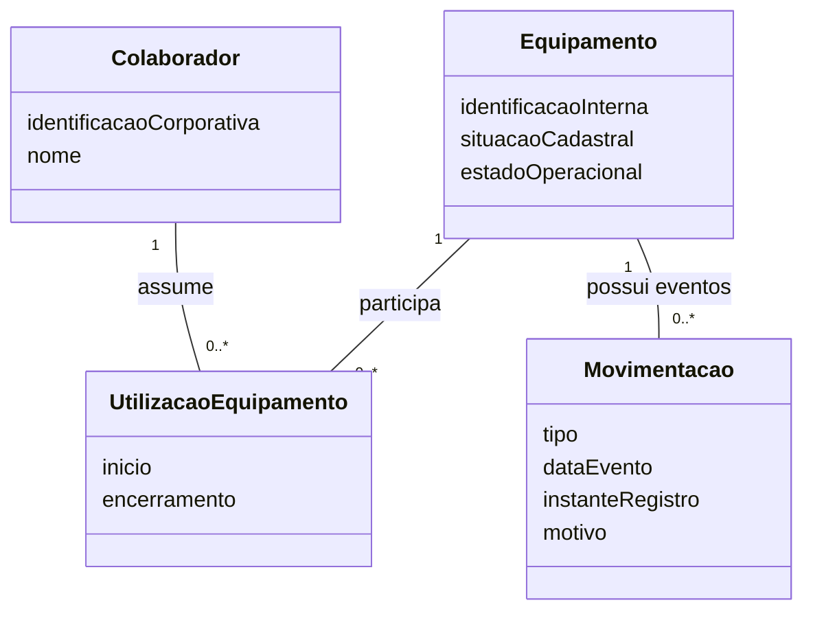

# 04 — Modelagem UML do projeto

## 1. Identificação e referências

| Campo | Registro |
| --- | --- |
| Projeto | Sistema de Controle de Ativos de TI |
| Versão | 0.1 — modelo conceitual preliminar |
| Data | 20/10/2026 |
| Base | Requisitos candidatos da etapa 03 |
| Situação | Proposta para revisão; sem aprovação empresarial ou acadêmica registrada |

Fontes:

- [Contexto central](../../CONTEXTO_SISTEMA_CONTROLE_ATIVOS_TI.md).
- [Escopo e proposta](../01-escopo-e-proposta/01-escopo-e-proposta.md).
- [Análise de viabilidade](../02-analise-de-viabilidade/02-analise-de-viabilidade.md).
- [Catálogo de requisitos](../03-analise-e-especificacao-de-requisitos/03-analise-e-especificacao-de-requisitos.md).

Este documento organiza a passagem de requisitos para modelos. Os diagramas são propostas conceituais, não retratos de um sistema implementado. RF, RNF, RN-P e Q mantêm os significados do catálogo da etapa 03. Não se inferem estruturas internas do Sankhya nem tabelas físicas a partir dos desenhos.

## 2. Objetivo e limites da modelagem

Representar quem interage com o sistema, quais objetivos são atendidos, quais conceitos sustentam o ciclo dos ativos e como operações críticas se comportam. A modelagem deve permitir identificar contradições antes de banco, API ou interface.

O ciclo prioritário proposto é recebimento → identificação → disponibilidade → saída/entrega → utilização → devolução → histórico. Telefonia e termos continuam condicionados à decisão de inclusão no primeiro ciclo. Transferência, manutenção, baixa e relatórios ampliados pertencem à visão de evolução, sem incremento aprovado.

Esta etapa fornece um mapa das visões e recortes iniciais. Não fecha os casos de uso da etapa 05, a matriz da etapa 06, o diagrama de classes da etapa 07, as sequências da etapa 08 ou as atividades da etapa 09. A documentação detalhada dessas etapas será produzida separadamente.

## 3. Convenções de leitura

- **Ator:** papel externo que interage com a aplicação; não é necessariamente pessoa física distinta.
- **Caso de uso:** objetivo observável de um ator, nomeado por verbo e objeto.
- **Classe conceitual:** conceito com identidade, informação ou responsabilidade; não equivale automaticamente a tabela ou classe PHP.
- **Associação:** vínculo entre conceitos ou interação ator–caso de uso; não indica ordem temporal.
- **Multiplicidade:** quantidade de instâncias associadas, conforme regra do domínio.
- **Hipótese H:** escolha provisória explicitada para permitir discutir o modelo.
- **Restrição:** condição aplicável ao comportamento ou à estrutura, vinculada a RN-P ou RNF.

Os blocos PlantUML e Mermaid são fontes textuais editáveis. PlantUML é usado para a notação de casos de uso; Mermaid para classes e sequência. Sua renderização depende do leitor. O fluxo de atividades é apresentado como roteiro textual para posterior diagrama UML, sem confundi-lo com um diagrama já finalizado.

## 4. Fronteira e contexto do sistema

A fronteira proposta é **Sistema de Controle de Ativos de TI**, aplicação web responsável por registrar e consultar o ciclo dos ativos com acesso autorizado e rastreabilidade.

| Dentro da fronteira proposta | Fora da fronteira inicial |
| --- | --- |
| Cadastros e permissões | Gestão integral de compras e fornecedores |
| Recebimento, identificação e estoque | Processo físico de transporte |
| Movimentação e utilização | Gestão integral de chamados externos |
| Histórico, auditoria e correções autorizadas | ERP, GLPI e diretórios corporativos existentes |
| Termos e telefonia, se aprovados no recorte | Assinatura eletrônica integrada e inventário automático |

Uma ação física, como entregar o aparelho, existe no processo empresarial. O sistema registra sua ocorrência; o desenho não significa que a aplicação executa fisicamente a entrega.

Planilhas são fontes documentais de levantamento e eventual migração, não atores. MySQL e a biblioteca interna de PDF são componentes técnicos, não atores de negócio. ERP/GLPI só se tornam atores em um modelo de integração quando houver interação externa efetivamente definida.

## 5. Atores candidatos e responsabilidades

| ID local | Ator | Objetivos candidatos | Condição |
| --- | --- | --- | --- |
| A01 | Operador de TI | Cadastrar, receber, entregar, registrar utilização e devolução | Permissões e abrangência a validar em Q01 |
| A02 | Gestor de TI | Consultar estoque, histórico e relatórios; aprovar quando definido | Aprovações ainda não especificadas |
| A03 | Administrador | Administrar usuários, permissões e configurações autorizadas | Não pressupõe acesso irrestrito a todo dado |
| A04 | Colaborador responsável | Participar de recebimento/devolução, se houver acesso direto | Não incluído como ator ativo nesta versão; Q01 e Q07 |
| A05 | Responsável de filial | Confirmar recebimento no destino, se esse fluxo for aprovado | Não incluído como ator ativo nesta versão; Q07 |

A04 e A05 podem ser apenas participantes do processo físico ou conceitos do domínio. Sua existência em um cadastro não comprova interação direta com o software. Uma pessoa pode exercer mais de um papel autorizado.

## 6. Visão preliminar de casos de uso

O desenho abaixo é um **recorte**, não a cobertura completa dos 25 RFs. Cada associação é candidata e está sujeita à matriz de acesso Q01. Não foi criada herança entre atores porque compartilhamento de permissões ainda não está estabelecido.

### Relações include, extend e generalização

Não se deve ligar “Registrar saída” a “Abrir utilização” com `include` antes de resolver Q07: os marcos podem ocorrer juntos ou em momentos diferentes. Dependência entre RFs também não prova relação `include` entre casos de uso.

Nesta versão, autenticação é uma capacidade própria, e estar autenticado é pré-condição das operações restritas. Não há `include` automático de login em todas as operações: uma sessão pode já estar válida.

Gerar termo não é automaticamente `extend` de abrir utilização. Se for etapa obrigatória da entrega, ou se puder ocorrer depois, a modelagem muda. É necessário resolver Q12 antes de escolher a relação.

Generalização só será usada quando um papel ou conceito for uma especialização substituível de outro. Não criar herança entre Cliente, Colaborador e Usuario apenas por compartilharem nome ou identificação.

## 7. Cobertura funcional para os próximos casos de uso

Os agrupamentos abaixo não substituem a especificação textual nem fixam a quantidade final de casos de uso.

| RFs | Objetivos a modelar | Papel candidato | Pendência principal |
| --- | --- | --- | --- |
| RF01–RF02 | Autenticar, encerrar sessão e administrar acesso | Usuário autorizado; administrador | Q01 |
| RF03–RF05 | Manter organização, colaboradores e classificações | Perfil de cadastro autorizado | Q02–Q03 |
| RF06–RF07 | Identificar equipamento e alterar situação cadastral | Operador/perfil autorizado | Q03–Q04 |
| RF08–RF09 | Registrar entrada e consultar estoque | Operador; gestor na consulta | Q05 |
| RF10 | Consultar ativo e histórico | Perfil autorizado | Q06 |
| RF11–RF12 | Registrar saída e abrir utilização | Operador | Q07 |
| RF13–RF14 | Consultar utilizações e registrar devolução | Operador; gestor na consulta | Q06–Q08 |
| RF15–RF17 | Transferir, encaminhar à manutenção e baixar | Perfil autorizado a definir | Q09 |
| RF18–RF19 | Manter telefonia e relacionar origem da solicitação | Perfil autorizado | Q10 |
| RF20–RF21 | Consultar auditoria e corrigir registros | Perfil autorizado; registro de auditoria é automático | Q11 |
| RF22–RF23 | Gerar e consultar termo | Perfil autorizado | Q12 |
| RF24 | Consultar indicadores e relatórios | Gestor | Q13 |
| RF25 | Importar legado validado | Perfil autorizado para migração | Q14 |

O registro automático de auditoria realiza parte de RF20, mas não exige um ator fictício “Sistema” iniciando caso de uso dentro de sua própria fronteira. A consulta da auditoria, por outro lado, possui objetivo externo identificável.

## 8. Conceitos e responsabilidades candidatos

| Conceito | Responsabilidade de domínio | Referências |
| --- | --- | --- |
| Equipamento | Identidade individual, classificação e situação atual | RF05–RF07 |
| Recebimento/entrada | Registrar chegada e associação às unidades recebidas | RF08 |
| Movimentacao | Registrar evento e origem/destino do ativo | RF11, RF14–RF17, RF21 |
| UtilizacaoEquipamento | Representar período de uso e responsabilidade | RF12–RF14 |
| Colaborador | Identificar pessoa envolvida na utilização | RF04 |
| Empresa, Filial e Local | Representar organização e localização pertinentes | RF03, RF08–RF09 |
| LinhaTelefonica e Operadora | Representar linha e seus vínculos, se aprovados | RF18 |
| UsuarioSistema e Permissao | Representar acesso e autorização | RF01–RF02 |
| Termo | Identificar emissão e vínculo documental com utilização | RF22–RF23 |
| RegistroAuditoria | Identificar ação, autor, instante e alteração relevante | RF20–RF21 |

Recebimento e entrada podem ser partes de uma operação ou conceitos separados; Q05 deve resolver. Local é conceito candidato, sem afirmar que corresponde a uma tabela ou que equivale a filial.

Computador e equipamento móvel podem exigir informações distintas. Antes de generalizar subclasses de Equipamento, verificar se existem diferenças de comportamento e invariantes ou apenas campos aplicáveis por tipo. A decisão pertence à etapa 07 e Q03.

## 9. Recorte conceitual de classes e associações

Hipóteses usadas apenas neste recorte:

- **H01:** cada registro individual de utilização referencia um equipamento; o equipamento pode ter várias utilizações ao longo do tempo.
- **H02:** cada utilização do recorte referencia um colaborador; entregas exclusivamente para uma loja exigem refinamento de destinatário e não estão resolvidas aqui.
- **H03:** cada movimentação individual referencia um equipamento. Uma operação em lote poderá agrupar várias movimentações, sem confundir lote com ativo.

As multiplicidades expressam histórico, não permissão de várias utilizações simultâneas. A regra candidata RN-P03 limita vínculos incompatíveis no mesmo intervalo, mas a cardinalidade histórica `0..*` permanece válida.

Atributos são conceituais e incompletos. Encerramento poderá estar ausente enquanto o vínculo estiver aberto; tipo, domínio e validação temporal ainda serão especificados. Nenhuma chave primária ou estrangeira foi definida neste diagrama.

Não se utiliza composição para apagar utilizações ao excluir equipamento: o requisito é preservar histórico. A opção de composição, se futuramente adotada por outro motivo de domínio, deverá ser justificada sem confundir UML com exclusão em cascata no banco.

### Associações que ainda não foram fixadas

| Relação | Por que permanece aberta |
| --- | --- |
| Empresa–Filial–Local | Níveis organizacionais, locais de estoque e reorganizações: Q02/Q05 |
| Equipamento–Recebimento | Lotes, cadastro anterior e entrada parcial: Q05 |
| Equipamento–LinhaTelefonica | Múltiplas linhas, troca de aparelho e períodos: Q10 |
| Colaborador–UsuarioSistema | Nem todo colaborador acessa a aplicação; Q01 |
| Utilizacao–Termo | Emissões, reemissões e versões: Q12 |
| Movimentacao–correção | Ajuste, estorno e cancelamento com rastreabilidade: Q11 |
| Equipamento–status | Estados, condição física e transições: Q04/Q08/Q09 |

## 10. Visão dinâmica: sequência conceitual de entrega

**Hipótese H04:** este cenário reúne saída e abertura de utilização numa única confirmação lógica. Q07 ainda poderá separar expedição, recebimento no destino e início da utilização. Se isso ocorrer, a sequência deverá ser dividida e o limite transacional redefinido.

Participantes de interface, aplicação e persistência representam responsabilidades, não classes PHP ou serviços implantados. A operação persistente abaixo é uma unidade lógica que deverá confirmar ou reverter movimentação, vínculo e auditoria exigida.

```mermaid
sequenceDiagram
  actor Operador as Operador de TI
  participant Interface as Interface web
  participant Aplicacao as Aplicacao e regras
  participant Persistencia as Persistencia transacional
  Operador->>Interface: Informar equipamento e destinatario
  Interface->>Aplicacao: Solicitar confirmacao
  Aplicacao->>Aplicacao: Verificar sessao, permissao e dados
  alt Acesso ou dados invalidos
    Aplicacao-->>Interface: Recusar sem efeito de negocio
  else Acesso e dados validos
    Aplicacao->>Persistencia: Executar entrega validando disponibilidade atual
    Note over Aplicacao,Persistencia: Verificacao e gravacao devem impedir conflito concorrente
    alt Equipamento indisponivel, conflito ou falha
      Persistencia-->>Aplicacao: Nenhuma alteracao parcial confirmada
      Aplicacao-->>Interface: Informar recusa ou falha
    else Equipamento elegivel e operacao confirmada
      Persistencia-->>Aplicacao: Identificacao da operacao confirmada
      Aplicacao-->>Interface: Confirmar saida e utilizacao
    end
  end
  Interface-->>Operador: Apresentar resultado
```

O desenho não fixa estratégia de bloqueio, isolamento ou idempotência. RNF04/RNF05 exigem que a arquitetura resolva esses pontos. Verificar disponibilidade apenas antes da transação é insuficiente para justificar proteção contra concorrência; a condição precisa permanecer protegida na confirmação.

Se a resposta se perder após confirmação, o reenvio deve reconhecer a operação já processada conforme política a definir, evitando uma segunda saída. Os detalhes serão tratados na etapa 08.

## 11. Visão de atividades: roteiro para devolução

O roteiro abaixo orientará a atividade UML da etapa 09. Não define paralelismo ou transições já aprovadas.

1. Operador solicita registrar devolução.
2. Aplicação verifica autenticação e permissão; negar acesso encerra a tentativa sem efeito operacional.
3. Identificar equipamento e utilização correspondente.
4. Se não houver vínculo elegível, apresentar inconsistência sem criar devolução fictícia.
5. Registrar dados de retorno e avaliação da condição, conforme Q08.
6. Determinar destino autorizado: estoque apto, manutenção ou outra destinação aprovada.
7. Confirmar encerramento da utilização, evento e atualização pertinente como unidade consistente.
8. Se houver falha ou conflito, não manter efeitos parciais e apresentar resultado claro.
9. Registrar auditoria exigida e apresentar referência da operação confirmada.

Na etapa de atividade, representar explicitamente decisões com guardas como `[vínculo elegível]` e `[apto para estoque]`, e respectivas alternativas. A auditoria obrigatória pertence à confirmação consistente do passo 7; o passo 9 destaca sua disponibilidade para consulta, não uma gravação opcional após sucesso.

## 12. Estados, eventos e restrições do ciclo de vida

Não é possível fechar uma máquina de estados antes de resolver Q04, Q05 e Q07–Q09. O contexto oferece nomes candidatos: em estoque, reservado, em trânsito, em uso, em manutenção, devolvido e baixado.

| Evento candidato | Efeito a discutir | Decisão necessária |
| --- | --- | --- |
| Recebimento concluído | Unidade identificada e elegível pode compor disponível | Cadastro parcial e condição de entrada |
| Separação/reserva | Pode restringir disponibilidade sem saída física | Existência e duração de reserva |
| Expedição | Pode registrar trânsito e reduzir disponível | Marco de saída e início de utilização |
| Entrega confirmada | Pode iniciar utilização no destinatário | Participante e confirmação no destino |
| Devolução avaliada | Encerra vínculo e direciona ativo conforme condição | Estoque, manutenção e exceções |
| Transferência | Atualiza origem/destino sem duplicar inventário | Transferência física versus responsabilidade |
| Baixa | Retira de conjuntos operacionais definidos | Aprovação, uso aberto e reversibilidade |

Ativo/inativo é situação cadastral separada. “Devolvido” não implica automaticamente “disponível”. Histórico de movimentação, situação cadastral e estado operacional são perspectivas relacionadas que precisam de regras de conciliação.

### Restrições a levar aos modelos detalhados

- **RN-P01:** saldo é explicável pelos eventos válidos do conjunto consultado.
- **RN-P02/RN-P03:** impedir nova utilização de inativo e vínculos incompatíveis conforme regra aprovada.
- **RN-P04/RN-P07:** devolução encerra o vínculo preservando seu histórico.
- **RN-P05:** identificadores seguem política específica por tipo, ainda aberta.
- **RN-P06:** saída registra data, destino e responsável.
- **RN-P08:** condição de retorno e estado cadastral não se confundem com disponibilidade.
- **RN-P09:** documento não é emitido silenciosamente incompleto.
- **RNF01–RNF06:** autorização, auditoria, proteção de credenciais, integridade, concorrência e validação acompanham operações críticas.

RNFs não devem virar elipses de casos de uso apenas para aparecer no desenho. Documentar sua aplicação a cenários, restrições e critérios de teste.

## 13. Plano dos artefatos UML e rastreabilidade

| Etapa | Artefato a detalhar | Base e foco |
| --- | --- | --- |
| 05 | Casos de uso e especificações textuais | Atores, RF01–RF25, pré/pós-condições, alternativas e exceções |
| 06 | Matriz de rastreabilidade | Necessidade → RF/RNF → RN-P → caso → conceito → cenário de teste |
| 07 | Diagrama de classes | Conceitos, atributos, responsabilidades e multiplicidades justificadas |
| 08 | Diagramas de sequência | Recebimento, saída/utilização, devolução, correção e termos |
| 09 | Diagramas de atividades | Processo e decisões de recebimento, entrega e retorno |
| 18 | Exportações de diagramas | PNG/SVG quando produzidos e verificados |

Fontes textuais deste arquivo não significam que existam arquivos PNG/SVG ou projetos Astah. Não foram gerados artefatos externos nesta entrega.

### Recortes desta versão e origem

| Recorte | Requisitos/regras | Questões que condicionam a revisão |
| --- | --- | --- |
| Casos de uso centrais | RF01, RF02, RF06, RF08–RF14 | Q01, Q05–Q08 |
| Classes conceituais | RF06, RF10, RF12–RF14; RN-P07 | Q02, Q03, Q06, Q07 |
| Sequência de entrega | RF11, RF12, RF20; RN-P02/RN-P03/RN-P06; RNF04/RNF05 | Q07, Q11 |
| Atividade de devolução | RF14, RF20; RN-P04/RN-P08 | Q08, Q11 |
| Estados candidatos | RF07–RF09, RF11–RF17; RN-P01/RN-P08 | Q04, Q05, Q07–Q09 |

## 14. Hipóteses, pendências e critérios de revisão

| Hipótese/pendência | Impacto | Encaminhamento |
| --- | --- | --- |
| H01 — utilização individual por equipamento | Multiplicidade histórica | Confirmar com exemplos de entrega |
| H02 — utilização do recorte referencia colaborador | Destino loja sem pessoa não está resolvido | Resolver Q02/Q07 antes de ampliar o diagrama |
| H03 — movimentação individual por ativo | Operações de lote exigem agrupamento | Resolver Q05 e estratégia de entrada |
| H04 — saída e uso numa confirmação lógica | Sequência e limite transacional | Resolver Q07 |
| A04/A05 têm acesso direto? | Atores e casos de confirmação | Resolver Q01/Q07 |
| Termos e telefonia entram no núcleo? | Casos, classes e sequências adicionais | Resolver Q10/Q12 |
| Correção, versões e retenção | Histórico, auditoria e documentos | Resolver Q11/Q12 |

Antes de aprovar um modelo:

- [ ] Conferir fronteira e atores reais, sem confundir cadastro com usuário.
- [ ] Justificar cada caso de uso pelos objetivos e RFs relacionados.
- [ ] Conferir pré-condições, alternativas e efeitos de falha.
- [ ] Justificar include, extend e generalizações sem automatismos.
- [ ] Validar multiplicidades históricas e limites simultâneos separadamente.
- [ ] Evitar composição e herança sem regra de domínio que as justifique.
- [ ] Conferir preservação de história, correções e termos antigos.
- [ ] Verificar concorrência, reenvio, autorização e atomicidade nos cenários críticos.
- [ ] Resolver ou registrar hipóteses que ainda bloqueiam fechamento.
- [ ] Revisar consistência entre classes, casos, sequências, atividades e requisitos.

## 15. Registro da versão e próximo passo

| Versão | Data | Registro |
| --- | --- | --- |
| 0.1 | 20/10/2026 | Visão UML preliminar com fronteira, atores, cobertura dos RFs, recortes textuais de casos/classes/sequência, roteiro de devolução e hipóteses; sem implementação |

Próximo detalhamento previsto: diagrama e especificação dos casos de uso, na etapa 05. A arquitetura e o DER deverão aproveitar os conceitos validados, sem transformar automaticamente este modelo conceitual em tabelas ou código.
