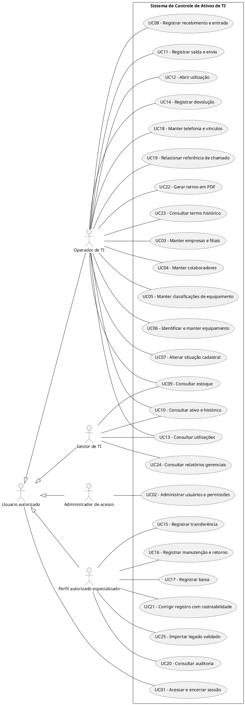

# 05 — Diagrama e especificação de casos de uso

## 1. Identificação, fontes e situação

| Campo | Registro |
| --- | --- |
| Projeto | Sistema de Controle de Ativos de TI |
| Versão | 0.1 — casos de uso candidatos |
| Data | 20/10/2026 |
| Origem do levantamento | Contexto fornecido por Bruno |
| Situação | Em revisão; sem aprovação do responsável empresarial |

Referências:

- [Contexto central](../../CONTEXTO_SISTEMA_CONTROLE_ATIVOS_TI.md).
- [Escopo](../01-escopo-e-proposta/01-escopo-e-proposta.md).
- [Viabilidade](../02-analise-de-viabilidade/02-analise-de-viabilidade.md).
- [Requisitos](../03-analise-e-especificacao-de-requisitos/03-analise-e-especificacao-de-requisitos.md).
- [Modelagem UML](../04-modelagem-uml/04-modelagem-uml.md).

Este documento detalha objetivos de interação e seus fluxos a partir dos requisitos candidatos. Não há funcionalidade implementada, teste executado ou aprovação implícita. Questões Q01–Q16 e regras RN-P01–RN-P09 remetem ao catálogo de requisitos.

## 2. Fronteira, atores e critérios de modelagem

A fronteira é a aplicação web Sistema de Controle de Ativos de TI. Transporte físico, compra, ERP e sistemas externos de chamados não são executados pela aplicação nesta versão.

| Ator | Papel proposto |
| --- | --- |
| Operador de TI | Operações de cadastro e ciclo do ativo conforme permissão |
| Gestor de TI | Consultas de gestão e operações expressamente autorizadas |
| Administrador | Gestão de acesso; demais ações somente com permissão própria |
| Perfil autorizado para cadastro/migração/correção | Papel ainda a atribuir aos usuários reais em Q01 |

Colaborador e responsável de filial não são atores ativos nesta versão: interação direta permanece pendente. Planilha, banco, componente de PDF e a própria aplicação não são atores de negócio. Auditoria automática é responsabilidade transversal. Nenhuma integração externa foi presumida.

A expressão “perfil autorizado” nos casos não cria um cargo real nem concede acesso automático ao administrador. No diagrama, o ator genérico “Usuário autorizado” representa o papel mínimo comum; os atores especializados herdam apenas sua participação de acesso. Permissões operacionais permanecem específicas. Trata-se de hipótese de organização dos papéis, a validar em Q01.

## 3. Convenções e garantias comuns

UC01–UC25 identificam objetivos neste documento; RF01–RF25 mantêm os IDs do catálogo. A correspondência inicial de um UC por RF foi escolhida para rastreabilidade nesta versão, não como regra geral de conversão. Um objetivo amplo de manutenção poderá ser decomposto posteriormente, preservando seus IDs e um mapa de correspondência.

Todos os casos são **CANDIDATOS — PENDENTE DE VALIDAÇÃO**. Prioridades são propostas. Fluxos descritos pressupõem as decisões necessárias ao cenário; quando uma Q bloqueante está aberta, o fluxo não constitui autorização de implementação.

### G01 — Acesso

Exceto entrada no UC01, operações restritas exigem sessão válida, autorização de ação e abrangência de dados. A autorização é conferida no backend. Negar acesso não altera dados de negócio e não revela dados restritos. O registro de tentativas segue política Q11 e não expõe segredos.

### G02 — Consistência e confirmação

Gravações confirmam efeitos de negócio e auditoria obrigatória de forma consistente. Falha não pode deixar vínculos, saldo ou documento de emissão parcialmente confirmados. Importação em lote depende da unidade de confirmação de Q14, sem prometer atomicidade do lote inteiro antes da decisão.

### G03 — Concorrência e reenvio

A elegibilidade precisa permanecer protegida até a confirmação. Tentativa concorrente incompatível é recusada sem efeito parcial. Reenvio de operação já confirmada não duplica efeitos, conforme política técnica futura; nova operação legítima não deve ser confundida com repetição.

### G04 — História, cancelamento e dados

Preservar identificação do evento original, data efetiva e instante de registro quando distintos. Cancelar antes da confirmação não cria evento de negócio; eventual rascunho depende de requisito futuro. Após confirmar, correções seguem UC21, não exclusão silenciosa. Não incluir senhas ou segredos em histórico.

### G05 — Mensagens e critérios de aceite

Erros devem identificar o problema corrigível sem expor SQL, credenciais ou detalhes internos. Critérios CA-RFxx-1/2 são herdados do catálogo e continuam candidatos. Os fluxos acrescentam contexto, sem alterar a redação original dos critérios.

## 4. Diagrama geral de objetivos

Fonte PlantUML editável. A renderização é dependente do leitor e ainda não foi verificada. Associações são propostas para Q01; agrupar casos visualmente não define módulos técnicos ou ordem temporal. Os objetivos condicionais e de evolução aparecem para mostrar a visão completa, sem indicar inclusão no MVP.

“Perfil autorizado especializado” é um marcador de responsabilidade pendente: não pressupõe que a mesma pessoa faça baixa, auditoria, correção e migração. A matriz Q01 deverá separar permissões e atribuir os papéis necessários. A herança de “Usuário autorizado” compartilha o acesso, sem conceder todos os casos a todos os perfis.

### Include, extend e pré-condições

Não foram impostas relações `include` ou `extend` sem decisão de domínio. Sessão válida é pré-condição, não obrigação de executar login a cada caso. UC11 e UC12 dependem do marco de entrega Q07; podem compor uma confirmação ou acontecer em momentos distintos. UC19 pode ocorrer no fluxo de saída ou depois, conforme decisão. UC22 não é extensão automática de utilização, pois sua obrigatoriedade e momento dependem de Q12.

Não se conecta auditoria automática como caso incluído em toda operação apenas para representar uma exigência técnica. G02 e RF20/RNF02 registram essa obrigação transversal; UC20 trata do objetivo externo de consultar auditoria.

## 5. Catálogo e especificações textuais

### UC01 — Acessar e encerrar sessão

- **Objetivo:** atender RF01 no contexto do processo autorizado, conforme resultado abaixo.
- **Ator principal/papel candidato:** Usuário do sistema.
- **Prioridade:** Núcleo.
- **Requisito de origem:** RF01; dependências/restrições do catálogo: RNF01 e RNF03.
- **Gatilho:** Usuário informa credenciais ou solicita sair.
- **Pré-condições específicas:** Credenciais de acesso provisionadas para o cenário de entrada; sessão existente para o cenário de saída.
- **Garantias comuns:** G01–G05 conforme a natureza da operação; UC01 não exige sessão prévia para autenticar.

**Fluxo principal candidato**

1. Usuário solicita acesso e informa credenciais.
2. Sistema verifica credenciais e habilitação sem revelar segredos.
3. Sistema estabelece sessão e apresenta as capacidades autorizadas.

**Alternativas**

- A1 — Alternativa de saída: usuário solicita sair; o sistema encerra a sessão e confirma o encerramento.
- A2 — Consulta e gravação respeitam a abrangência de dados autorizada; cancelar antes da confirmação segue G04.

**Exceções**

- E1 — Sessão/permissão inválida: recusar conforme G01; no login, credenciais inválidas não criam sessão.
- E2 — Dados obrigatórios ausentes, referência inválida ou regra não atendida: informar a inconsistência e não confirmar efeito de negócio.
- E3 — Falha técnica, concorrência ou reenvio: aplicar G02/G03 no que couber. Consulta não modifica dados; gravação não deixa resultado parcial indevido.

**Pós-condições**

- Sucesso: Sessão válida iniciada ou sessão encerrada, conforme objetivo escolhido.
- Insucesso: nenhum efeito de negócio indevido é confirmado; evidência de tentativa/erro segue política aprovada, sem substituir histórico válido.

**Critérios de aceite herdados**

- CA-RF01-1 — Com credenciais válidas de usuário habilitado, iniciar sessão e apresentar somente as capacidades autorizadas.
- CA-RF01-2 — Com credenciais inválidas ou usuário desabilitado, negar acesso; após sair, a sessão encerrada não permite operação restrita.

**Pendências de fechamento:** Provisionamento inicial, recuperação de acesso e tempos de sessão: Q01.

### UC02 — Administrar usuários e permissões

- **Objetivo:** atender RF02 no contexto do processo autorizado, conforme resultado abaixo.
- **Ator principal/papel candidato:** Administrador autorizado.
- **Prioridade:** Núcleo.
- **Requisito de origem:** RF02; dependências/restrições do catálogo: RF01 e RNF01.
- **Gatilho:** Administrador solicita criar ou alterar acesso.
- **Pré-condições específicas:** Administrador possui permissão explícita de gestão de acesso.
- **Garantias comuns:** G01–G05 conforme a natureza da operação; UC01 não exige sessão prévia para autenticar.

**Fluxo principal candidato**

1. Administrador seleciona usuário ou inicia cadastro.
2. Sistema apresenta dados de acesso e permissões que o administrador pode gerir.
3. Administrador informa ou altera habilitação e permissões.
4. Sistema valida a política e confirma a alteração com rastreabilidade.

**Alternativas**

- A1 — Alteração de permissão em sessão já aberta segue política Q01; não presumir efeito imediato ou somente no próximo login.
- A2 — Consulta e gravação respeitam a abrangência de dados autorizada; cancelar antes da confirmação segue G04.

**Exceções**

- E1 — Sessão/permissão inválida: recusar conforme G01; no login, credenciais inválidas não criam sessão.
- E2 — Dados obrigatórios ausentes, referência inválida ou regra não atendida: informar a inconsistência e não confirmar efeito de negócio.
- E3 — Falha técnica, concorrência ou reenvio: aplicar G02/G03 no que couber. Consulta não modifica dados; gravação não deixa resultado parcial indevido.

**Pós-condições**

- Sucesso: Configuração de acesso válida registrada e efeito aplicado conforme política aprovada.
- Insucesso: nenhum efeito de negócio indevido é confirmado; evidência de tentativa/erro segue política aprovada, sem substituir histórico válido.

**Critérios de aceite herdados**

- CA-RF02-1 — Uma alteração autorizada de permissão modifica o acesso conforme política aprovada e deixa registro rastreável.
- CA-RF02-2 — Uma tentativa sem permissão de administrar acesso é recusada e não modifica o usuário-alvo.

**Pendências de fechamento:** Papéis, abrangência por empresa/filial e efeito da revogação em sessão aberta: Q01.

### UC03 — Manter empresas e filiais

- **Objetivo:** atender RF03 no contexto do processo autorizado, conforme resultado abaixo.
- **Ator principal/papel candidato:** Perfil autorizado.
- **Prioridade:** Núcleo.
- **Requisito de origem:** RF03; dependências/restrições do catálogo: RF01, RF02 e RN-P07.
- **Gatilho:** Perfil autorizado solicita manutenção de cadastro organizacional.
- **Pré-condições específicas:** Estrutura de empresa e filial aplicável ao cadastro definida.
- **Garantias comuns:** G01–G05 conforme a natureza da operação; UC01 não exige sessão prévia para autenticar.

**Fluxo principal candidato**

1. Ator inicia cadastro ou seleciona registro existente.
2. Sistema apresenta campos e vínculos permitidos.
3. Ator informa identificação e relação organizacional.
4. Sistema valida referências e registra a versão/alteração pertinente.

**Alternativas**

- A1 — Consulta sem alteração retorna os dados permitidos; reorganização de vínculos depende de Q02.
- A2 — Consulta e gravação respeitam a abrangência de dados autorizada; cancelar antes da confirmação segue G04.

**Exceções**

- E1 — Sessão/permissão inválida: recusar conforme G01; no login, credenciais inválidas não criam sessão.
- E2 — Dados obrigatórios ausentes, referência inválida ou regra não atendida: informar a inconsistência e não confirmar efeito de negócio.
- E3 — Falha técnica, concorrência ou reenvio: aplicar G02/G03 no que couber. Consulta não modifica dados; gravação não deixa resultado parcial indevido.

**Pós-condições**

- Sucesso: Empresa/filial consultada ou mantida sem romper referências e histórico.
- Insucesso: nenhum efeito de negócio indevido é confirmado; evidência de tentativa/erro segue política aprovada, sem substituir histórico válido.

**Critérios de aceite herdados**

- CA-RF03-1 — Uma filial é relacionada à empresa válida e pode ser consultada pelos perfis permitidos.
- CA-RF03-2 — Referência a empresa inexistente é recusada; alteração não apaga vínculos históricos.

**Pendências de fechamento:** Campos, obrigatoriedade e possibilidade de reorganização empresarial: Q02.

### UC04 — Manter colaboradores

- **Objetivo:** atender RF04 no contexto do processo autorizado, conforme resultado abaixo.
- **Ator principal/papel candidato:** Perfil autorizado.
- **Prioridade:** Núcleo.
- **Requisito de origem:** RF04; dependências/restrições do catálogo: RF03 e RN-P07.
- **Gatilho:** Ator solicita cadastro, consulta ou atualização de colaborador.
- **Pré-condições específicas:** Organização necessária ao vínculo está cadastrada.
- **Garantias comuns:** G01–G05 conforme a natureza da operação; UC01 não exige sessão prévia para autenticar.

**Fluxo principal candidato**

1. Ator identifica colaborador ou solicita novo cadastro.
2. Sistema apresenta identificação e vínculo organizacional pertinente.
3. Ator informa dados necessários e situação.
4. Sistema valida referências e confirma cadastro/alteração rastreável.

**Alternativas**

- A1 — Desligamento ou mudança organizacional preserva vínculos anteriores conforme política Q02.
- A2 — Consulta e gravação respeitam a abrangência de dados autorizada; cancelar antes da confirmação segue G04.

**Exceções**

- E1 — Sessão/permissão inválida: recusar conforme G01; no login, credenciais inválidas não criam sessão.
- E2 — Dados obrigatórios ausentes, referência inválida ou regra não atendida: informar a inconsistência e não confirmar efeito de negócio.
- E3 — Falha técnica, concorrência ou reenvio: aplicar G02/G03 no que couber. Consulta não modifica dados; gravação não deixa resultado parcial indevido.

**Pós-condições**

- Sucesso: Colaborador identificado e dados válidos disponíveis ao processo autorizado.
- Insucesso: nenhum efeito de negócio indevido é confirmado; evidência de tentativa/erro segue política aprovada, sem substituir histórico válido.

**Critérios de aceite herdados**

- CA-RF04-1 — Um colaborador cadastrado pode ser identificado no processo de entrega com o vínculo organizacional pertinente.
- CA-RF04-2 — Referência organizacional inválida é recusada; desligamento não apaga utilizações anteriores.

**Pendências de fechamento:** Identificador corporativo e forma de preservar mudanças de empresa/filial: Q02.

### UC05 — Manter classificações de equipamento

- **Objetivo:** atender RF05 no contexto do processo autorizado, conforme resultado abaixo.
- **Ator principal/papel candidato:** Perfil autorizado.
- **Prioridade:** Núcleo.
- **Requisito de origem:** RF05; dependências/restrições do catálogo: RF02 e RNF04.
- **Gatilho:** Ator solicita manter tipo, fabricante ou modelo.
- **Pré-condições específicas:** Relações permitidas entre classificações definidas para o cenário.
- **Garantias comuns:** G01–G05 conforme a natureza da operação; UC01 não exige sessão prévia para autenticar.

**Fluxo principal candidato**

1. Ator seleciona classificação e ação de manutenção.
2. Sistema apresenta campos e relações existentes.
3. Ator informa tipo, fabricante ou modelo pertinente.
4. Sistema valida combinação e registra o cadastro.

**Alternativas**

- A1 — Consulta não modifica dados; alteração de classificação já utilizada preserva referências e segue Q03.
- A2 — Consulta e gravação respeitam a abrangência de dados autorizada; cancelar antes da confirmação segue G04.

**Exceções**

- E1 — Sessão/permissão inválida: recusar conforme G01; no login, credenciais inválidas não criam sessão.
- E2 — Dados obrigatórios ausentes, referência inválida ou regra não atendida: informar a inconsistência e não confirmar efeito de negócio.
- E3 — Falha técnica, concorrência ou reenvio: aplicar G02/G03 no que couber. Consulta não modifica dados; gravação não deixa resultado parcial indevido.

**Pós-condições**

- Sucesso: Classificação válida disponível para identificar equipamentos.
- Insucesso: nenhum efeito de negócio indevido é confirmado; evidência de tentativa/erro segue política aprovada, sem substituir histórico válido.

**Critérios de aceite herdados**

- CA-RF05-1 — Um equipamento pode selecionar classificação válida e consultar a descrição correspondente.
- CA-RF05-2 — Uma combinação proibida pelas relações aprovadas é recusada sem gravar referência inconsistente.

**Pendências de fechamento:** Dependências entre tipo, modelo e fabricante e campos por categoria: Q03.

### UC06 — Identificar e manter equipamento

- **Objetivo:** atender RF06 no contexto do processo autorizado, conforme resultado abaixo.
- **Ator principal/papel candidato:** Operador de TI autorizado.
- **Prioridade:** Núcleo.
- **Requisito de origem:** RF06; dependências/restrições do catálogo: RF05, RN-P01, RN-P05 e RN-P07.
- **Gatilho:** Operador inicia identificação de uma unidade ou altera dados cadastrais.
- **Pré-condições específicas:** Tipo e classificações necessários estão disponíveis; política de identificadores definida para o tipo.
- **Garantias comuns:** G01–G05 conforme a natureza da operação; UC01 não exige sessão prévia para autenticar.

**Fluxo principal candidato**

1. Operador seleciona tipo e informa características da unidade.
2. Sistema solicita identificadores aplicáveis e valida formatos e unicidade aprovados.
3. Sistema atribui identificação interna distinta no cadastro ou preserva a identidade na atualização.
4. Sistema registra os dados e apresenta referência do equipamento.

**Alternativas**

- A1 — Identificador inaplicável ao tipo pode ficar ausente segundo política; múltiplos IMEIs exigem decisão Q03.
- A2 — Consulta e gravação respeitam a abrangência de dados autorizada; cancelar antes da confirmação segue G04.

**Exceções**

- E1 — Sessão/permissão inválida: recusar conforme G01; no login, credenciais inválidas não criam sessão.
- E2 — Dados obrigatórios ausentes, referência inválida ou regra não atendida: informar a inconsistência e não confirmar efeito de negócio.
- E3 — Falha técnica, concorrência ou reenvio: aplicar G02/G03 no que couber. Consulta não modifica dados; gravação não deixa resultado parcial indevido.

**Pós-condições**

- Sucesso: Unidade identificada individualmente; cadastro não gera entrada fictícia nem saldo sem movimentação.
- Insucesso: nenhum efeito de negócio indevido é confirmado; evidência de tentativa/erro segue política aprovada, sem substituir histórico válido.

**Critérios de aceite herdados**

- CA-RF06-1 — No recebimento de 25 celulares, cada unidade concluída possui identificação interna distinta e pode ser consultada individualmente.
- CA-RF06-2 — Identificador que viole a política de unicidade aprovada é recusado; não tornar obrigatório um campo inaplicável ao tipo.

**Pendências de fechamento:** Campos obrigatórios, IMEI múltiplo, serial, service tag e hostname: Q03.

### UC07 — Alterar situação cadastral

- **Objetivo:** atender RF07 no contexto do processo autorizado, conforme resultado abaixo.
- **Ator principal/papel candidato:** Perfil autorizado.
- **Prioridade:** Núcleo.
- **Requisito de origem:** RF07; dependências/restrições do catálogo: RF06, RN-P02 e RN-P07.
- **Gatilho:** Ator solicita ativar ou inativar equipamento.
- **Pré-condições específicas:** Equipamento identificado; política de alteração durante utilização definida para o cenário.
- **Garantias comuns:** G01–G05 conforme a natureza da operação; UC01 não exige sessão prévia para autenticar.

**Fluxo principal candidato**

1. Ator seleciona equipamento e nova situação cadastral.
2. Sistema apresenta situação atual e vínculos relevantes.
3. Ator informa justificativa quando exigida e confirma.
4. Sistema valida a transição cadastral e registra alteração com histórico.

**Alternativas**

- A1 — Reativação segue a regra aprovada; não reabre automaticamente utilização nem desfaz baixa.
- A2 — Consulta e gravação respeitam a abrangência de dados autorizada; cancelar antes da confirmação segue G04.

**Exceções**

- E1 — Sessão/permissão inválida: recusar conforme G01; no login, credenciais inválidas não criam sessão.
- E2 — Dados obrigatórios ausentes, referência inválida ou regra não atendida: informar a inconsistência e não confirmar efeito de negócio.
- E3 — Falha técnica, concorrência ou reenvio: aplicar G02/G03 no que couber. Consulta não modifica dados; gravação não deixa resultado parcial indevido.

**Pós-condições**

- Sucesso: Situação cadastral alterada sem apagar histórico ou simular movimentação física.
- Insucesso: nenhum efeito de negócio indevido é confirmado; evidência de tentativa/erro segue política aprovada, sem substituir histórico válido.

**Critérios de aceite herdados**

- CA-RF07-1 — Após inativação autorizada, o cadastro é identificado como inativo e utilizações antigas continuam consultáveis.
- CA-RF07-2 — Inativar não elimina histórico nem representa automaticamente uma baixa ou retorno ao estoque.

**Pendências de fechamento:** Inativação durante utilização aberta, reativação e justificativa obrigatória: Q04.

### UC08 — Registrar recebimento e entrada

- **Objetivo:** atender RF08 no contexto do processo autorizado, conforme resultado abaixo.
- **Ator principal/papel candidato:** Operador de TI autorizado.
- **Prioridade:** Núcleo.
- **Requisito de origem:** RF08; dependências/restrições do catálogo: RF03, RF06, RN-P01 e RNF04.
- **Gatilho:** Operador registra chegada física de equipamentos.
- **Pré-condições específicas:** Local de destino e política de conclusão/identificação da entrada definidos.
- **Garantias comuns:** G01–G05 conforme a natureza da operação; UC01 não exige sessão prévia para autenticar.

**Fluxo principal candidato**

1. Operador informa origem, data, local e quantidade recebida.
2. Sistema permite relacionar as unidades individualmente identificadas.
3. Sistema confere quantidade, referências e eventual repetição de operação.
4. Operador confirma a entrada.
5. Sistema confirma eventos e disponibilidade elegível com auditoria em unidade consistente.

**Alternativas**

- A1 — Recebimento parcial ou unidades ainda não identificadas seguem Q05; não pressupor disponibilidade antes da conclusão elegível.
- A2 — Consulta e gravação respeitam a abrangência de dados autorizada; cancelar antes da confirmação segue G04.

**Exceções**

- E1 — Sessão/permissão inválida: recusar conforme G01; no login, credenciais inválidas não criam sessão.
- E2 — Dados obrigatórios ausentes, referência inválida ou regra não atendida: informar a inconsistência e não confirmar efeito de negócio.
- E3 — Falha técnica, concorrência ou reenvio: aplicar G02/G03 no que couber. Consulta não modifica dados; gravação não deixa resultado parcial indevido.

**Pós-condições**

- Sucesso: Recebimento e unidades conciliáveis, com saldo afetado uma única vez pelo evento válido.
- Insucesso: nenhum efeito de negócio indevido é confirmado; evidência de tentativa/erro segue política aprovada, sem substituir histórico válido.

**Critérios de aceite herdados**

- CA-RF08-1 — Uma entrada concluída de 25 unidades permite conciliar as 25 identificações com a quantidade recebida e o local definido.
- CA-RF08-2 — Uma entrada não pode ser contabilizada duas vezes por repetição do mesmo envio confirmado; falha não deixa disponibilidade sem lastro.

**Pendências de fechamento:** Entrada parcial, unidades ainda não identificadas, documentos de origem e duplicidade de recebimento: Q05.

### UC09 — Consultar estoque

- **Objetivo:** atender RF09 no contexto do processo autorizado, conforme resultado abaixo.
- **Ator principal/papel candidato:** Operador ou gestor autorizado.
- **Prioridade:** Núcleo.
- **Requisito de origem:** RF09; dependências/restrições do catálogo: RF08, RF11, RF14 e RN-P01.
- **Gatilho:** Operador ou gestor solicita posição de estoque.
- **Pré-condições específicas:** Critério de disponibilidade e abrangência de consulta definido.
- **Garantias comuns:** G01–G05 conforme a natureza da operação; UC01 não exige sessão prévia para autenticar.

**Fluxo principal candidato**

1. Ator informa local, condição e demais filtros aprovados.
2. Sistema aplica autorização e critérios do conjunto consultado.
3. Sistema calcula ou obtém posição conciliável com eventos válidos.
4. Sistema apresenta saldo e unidades correspondentes.

**Alternativas**

- A1 — Conjunto sem unidades retorna saldo zero e lista vazia; consulta histórica exige política de data de corte Q05.
- A2 — Consulta e gravação respeitam a abrangência de dados autorizada; cancelar antes da confirmação segue G04.

**Exceções**

- E1 — Sessão/permissão inválida: recusar conforme G01; no login, credenciais inválidas não criam sessão.
- E2 — Dados obrigatórios ausentes, referência inválida ou regra não atendida: informar a inconsistência e não confirmar efeito de negócio.
- E3 — Falha técnica, concorrência ou reenvio: aplicar G02/G03 no que couber. Consulta não modifica dados; gravação não deixa resultado parcial indevido.

**Pós-condições**

- Sucesso: Posição consultada sem alterar ativos ou movimentações.
- Insucesso: nenhum efeito de negócio indevido é confirmado; evidência de tentativa/erro segue política aprovada, sem substituir histórico válido.

**Critérios de aceite herdados**

- CA-RF09-1 — Em cenário aprovado de entrada 25, saída 5 e devolução 1 apta a retornar, apresentar saldo 21 e lista conciliável.
- CA-RF09-2 — Ativo em uso não aparece como disponível; transferência entre locais não cria aumento artificial no total da empresa.

**Pendências de fechamento:** Conceito de disponível, reservas, data de corte, cancelamentos e níveis de agregação: Q05.

### UC10 — Consultar ativo e histórico

- **Objetivo:** atender RF10 no contexto do processo autorizado, conforme resultado abaixo.
- **Ator principal/papel candidato:** Perfil autorizado.
- **Prioridade:** Núcleo.
- **Requisito de origem:** RF10; dependências/restrições do catálogo: RF06, RF20, RF21 e RN-P07.
- **Gatilho:** Ator busca um equipamento e sua trajetória.
- **Pré-condições específicas:** Identificação ou critério de busca disponível.
- **Garantias comuns:** G01–G05 conforme a natureza da operação; UC01 não exige sessão prévia para autenticar.

**Fluxo principal candidato**

1. Ator informa identificador ou filtro permitido.
2. Sistema localiza registros dentro da abrangência autorizada.
3. Ator seleciona o equipamento.
4. Sistema apresenta situação, localização, vínculos e eventos históricos pertinentes.

**Alternativas**

- A1 — Equipamento inativo continua consultável conforme permissão; nenhum resultado é apresentado como ausência de registros, sem criar cadastro.
- A2 — Consulta e gravação respeitam a abrangência de dados autorizada; cancelar antes da confirmação segue G04.

**Exceções**

- E1 — Sessão/permissão inválida: recusar conforme G01; no login, credenciais inválidas não criam sessão.
- E2 — Dados obrigatórios ausentes, referência inválida ou regra não atendida: informar a inconsistência e não confirmar efeito de negócio.
- E3 — Falha técnica, concorrência ou reenvio: aplicar G02/G03 no que couber. Consulta não modifica dados; gravação não deixa resultado parcial indevido.

**Pós-condições**

- Sucesso: Histórico consultado preservando distinção entre data do evento e instante do registro.
- Insucesso: nenhum efeito de negócio indevido é confirmado; evidência de tentativa/erro segue política aprovada, sem substituir histórico válido.

**Critérios de aceite herdados**

- CA-RF10-1 — A consulta permite identificar recebimento, saída, destinatário e devolução do ativo de teste com suas referências.
- CA-RF10-2 — Inativação de cadastro não oculta utilizações antigas; perfil sem acesso não consulta dados restritos.

**Pendências de fechamento:** Busca, filtros, ordenação de eventos retroativos e visibilidade por perfil: Q06.

### UC11 — Registrar saída e envio

- **Objetivo:** atender RF11 no contexto do processo autorizado, conforme resultado abaixo.
- **Ator principal/papel candidato:** Operador de TI autorizado.
- **Prioridade:** Núcleo.
- **Requisito de origem:** RF11; dependências/restrições do catálogo: RF09, RF12, RF19, RN-P03 e RN-P06.
- **Gatilho:** Operador solicita destinar equipamento para envio.
- **Pré-condições específicas:** Equipamento e destino identificados; marco de saída e elegibilidade definidos para o cenário.
- **Garantias comuns:** G01–G05 conforme a natureza da operação; UC01 não exige sessão prévia para autenticar.

**Fluxo principal candidato**

1. Operador seleciona equipamento e informa destino, data e origem da solicitação quando aplicável.
2. Sistema verifica permissão, campos e elegibilidade atual do ativo.
3. Sistema apresenta os efeitos previstos para confirmação.
4. Operador confirma a saída.
5. Sistema registra saída e efeitos aprovados de forma consistente e apresenta referência da operação.

**Alternativas**

- A1 — Se envio e entrega forem marcos distintos, registrar apenas os efeitos do marco atual; utilização posterior seguirá UC12.
- A2 — Consulta e gravação respeitam a abrangência de dados autorizada; cancelar antes da confirmação segue G04.

**Exceções**

- E1 — Sessão/permissão inválida: recusar conforme G01; no login, credenciais inválidas não criam sessão.
- E2 — Dados obrigatórios ausentes, referência inválida ou regra não atendida: informar a inconsistência e não confirmar efeito de negócio.
- E3 — Falha técnica, concorrência ou reenvio: aplicar G02/G03 no que couber. Consulta não modifica dados; gravação não deixa resultado parcial indevido.

**Pós-condições**

- Sucesso: Saída registrada uma única vez; saldo e condição refletem o marco definido, sem criar automaticamente vínculo antes do momento aprovado.
- Insucesso: nenhum efeito de negócio indevido é confirmado; evidência de tentativa/erro segue política aprovada, sem substituir histórico válido.

**Critérios de aceite herdados**

- CA-RF11-1 — Uma saída válida fica vinculada ao ativo e destino e afeta o saldo uma única vez, no marco operacional aprovado.
- CA-RF11-2 — Equipamento indisponível ou destino obrigatório ausente impede confirmação; nenhum vínculo parcial permanece após falha.

**Pendências de fechamento:** Separação, reserva, expedição, trânsito e momento exato de redução do saldo: Q07.

### UC12 — Abrir utilização

- **Objetivo:** atender RF12 no contexto do processo autorizado, conforme resultado abaixo.
- **Ator principal/papel candidato:** Operador de TI autorizado.
- **Prioridade:** Núcleo.
- **Requisito de origem:** RF12; dependências/restrições do catálogo: RF04, RF06, RF11, RN-P02 e RN-P03.
- **Gatilho:** Operador registra início de responsabilidade/uso.
- **Pré-condições específicas:** Equipamento elegível, colaborador e empresa definidos; política do marco de início aprovada para o cenário.
- **Garantias comuns:** G01–G05 conforme a natureza da operação; UC01 não exige sessão prévia para autenticar.

**Fluxo principal candidato**

1. Operador informa equipamento, destinatário, empresa, data de início e linha quando aplicável.
2. Sistema verifica cadastro ativo e ausência de vínculo incompatível.
3. Operador confirma os dados da utilização.
4. Sistema confirma vínculo e efeitos relacionados com proteção contra conflito concorrente.
5. Sistema apresenta identificação da utilização.

**Alternativas**

- A1 — Se a utilização integrar a mesma confirmação de saída, coordenar UC11/UC12 sem repetir efeito no saldo; H04 continua pendente.
- A2 — Consulta e gravação respeitam a abrangência de dados autorizada; cancelar antes da confirmação segue G04.

**Exceções**

- E1 — Sessão/permissão inválida: recusar conforme G01; no login, credenciais inválidas não criam sessão.
- E2 — Dados obrigatórios ausentes, referência inválida ou regra não atendida: informar a inconsistência e não confirmar efeito de negócio.
- E3 — Falha técnica, concorrência ou reenvio: aplicar G02/G03 no que couber. Consulta não modifica dados; gravação não deixa resultado parcial indevido.

**Pós-condições**

- Sucesso: Utilização válida aberta e rastreável, sem vínculo incompatível ou entrega duplicada.
- Insucesso: nenhum efeito de negócio indevido é confirmado; evidência de tentativa/erro segue política aprovada, sem substituir histórico válido.

**Critérios de aceite herdados**

- CA-RF12-1 — Uma entrega válida cria vínculo de utilização consultável com equipamento, destinatário e responsável pela operação.
- CA-RF12-2 — Equipamento inativo ou já em uso não recebe vínculo incompatível segundo a regra aprovada, inclusive em tentativas concorrentes.

**Pendências de fechamento:** Momento de abertura em relação ao envio e confirmação de entrega; exceções de vínculo aberto: Q07.

### UC13 — Consultar utilizações

- **Objetivo:** atender RF13 no contexto do processo autorizado, conforme resultado abaixo.
- **Ator principal/papel candidato:** Operador ou gestor autorizado.
- **Prioridade:** Núcleo.
- **Requisito de origem:** RF13; dependências/restrições do catálogo: RF12, RF14 e RN-P07.
- **Gatilho:** Ator busca utilizações por equipamento ou colaborador.
- **Pré-condições específicas:** Critério de vínculo aberto/encerrado definido para a consulta.
- **Garantias comuns:** G01–G05 conforme a natureza da operação; UC01 não exige sessão prévia para autenticar.

**Fluxo principal candidato**

1. Ator informa equipamento, colaborador ou período permitido.
2. Sistema aplica autorização e filtros.
3. Sistema lista os vínculos e seus períodos separadamente.
4. Ator consulta o detalhe do vínculo selecionado.

**Alternativas**

- A1 — Sem correspondência, informar lista vazia; vínculo encerrado não é substituído pelo atual.
- A2 — Consulta e gravação respeitam a abrangência de dados autorizada; cancelar antes da confirmação segue G04.

**Exceções**

- E1 — Sessão/permissão inválida: recusar conforme G01; no login, credenciais inválidas não criam sessão.
- E2 — Dados obrigatórios ausentes, referência inválida ou regra não atendida: informar a inconsistência e não confirmar efeito de negócio.
- E3 — Falha técnica, concorrência ou reenvio: aplicar G02/G03 no que couber. Consulta não modifica dados; gravação não deixa resultado parcial indevido.

**Pós-condições**

- Sucesso: Utilizações consultadas sem modificar seus períodos.
- Insucesso: nenhum efeito de negócio indevido é confirmado; evidência de tentativa/erro segue política aprovada, sem substituir histórico válido.

**Critérios de aceite herdados**

- CA-RF13-1 — Para ativo devolvido e depois entregue novamente, apresentar os dois vínculos separadamente com seus períodos.
- CA-RF13-2 — Alteração do responsável atual não substitui o destinatário do vínculo anterior.

**Pendências de fechamento:** Ausência de data de devolução como critério suficiente de abertura e filtros: Q06 e Q07.

### UC14 — Registrar devolução

- **Objetivo:** atender RF14 no contexto do processo autorizado, conforme resultado abaixo.
- **Ator principal/papel candidato:** Operador de TI autorizado.
- **Prioridade:** Núcleo.
- **Requisito de origem:** RF14; dependências/restrições do catálogo: RF12, RN-P04 e RN-P08.
- **Gatilho:** Operador recebe equipamento para devolução.
- **Pré-condições específicas:** Equipamento e utilização elegível identificados; condição e destino de retorno definidos para o cenário.
- **Garantias comuns:** G01–G05 conforme a natureza da operação; UC01 não exige sessão prévia para autenticar.

**Fluxo principal candidato**

1. Operador seleciona utilização e informa data e dados de retorno.
2. Sistema valida vínculo, período e condição apresentada.
3. Operador registra avaliação e destino autorizado.
4. Operador confirma a devolução.
5. Sistema encerra vínculo, registra evento e atualiza situação/local pertinente em unidade consistente.

**Alternativas**

- A1 — Retorno que exige manutenção não fica disponível automaticamente; devolução repetida não acrescenta outra unidade.
- A2 — Consulta e gravação respeitam a abrangência de dados autorizada; cancelar antes da confirmação segue G04.

**Exceções**

- E1 — Sessão/permissão inválida: recusar conforme G01; no login, credenciais inválidas não criam sessão.
- E2 — Dados obrigatórios ausentes, referência inválida ou regra não atendida: informar a inconsistência e não confirmar efeito de negócio.
- E3 — Falha técnica, concorrência ou reenvio: aplicar G02/G03 no que couber. Consulta não modifica dados; gravação não deixa resultado parcial indevido.

**Pós-condições**

- Sucesso: Utilização encerrada e ativo destinado conforme avaliação, com histórico preservado.
- Insucesso: nenhum efeito de negócio indevido é confirmado; evidência de tentativa/erro segue política aprovada, sem substituir histórico válido.

**Critérios de aceite herdados**

- CA-RF14-1 — Ao devolver ativo apto, encerrar o vínculo e disponibilizar a unidade no local aprovado, com histórico preservado.
- CA-RF14-2 — Ativo devolvido com necessidade de manutenção não fica automaticamente disponível; devolução repetida não soma outra unidade.

**Pendências de fechamento:** Devolução parcial de conjunto, datas retroativas, avaliador e destino pós-retorno: Q08.

### UC15 — Registrar transferência

- **Objetivo:** atender RF15 no contexto do processo autorizado, conforme resultado abaixo.
- **Ator principal/papel candidato:** Perfil autorizado.
- **Prioridade:** Evolução.
- **Requisito de origem:** RF15; dependências/restrições do catálogo: RF10, RF12, RN-P01 e RN-P08.
- **Gatilho:** Ator solicita transferência de local ou responsabilidade.
- **Pré-condições específicas:** Modalidade, origem, destino e autorizações definidos para o cenário.
- **Garantias comuns:** G01–G05 conforme a natureza da operação; UC01 não exige sessão prévia para autenticar.

**Fluxo principal candidato**

1. Ator identifica ativo e modalidade de transferência.
2. Sistema apresenta localização/vínculo atual e valida elegibilidade.
3. Ator informa destino e dados exigidos e confirma.
4. Sistema registra eventos e efeitos da modalidade, preservando referências anteriores.

**Alternativas**

- A1 — Transferência apenas de local pode diferir de mudança de responsável; não encerrar utilização automaticamente sem regra Q09.
- A2 — Consulta e gravação respeitam a abrangência de dados autorizada; cancelar antes da confirmação segue G04.

**Exceções**

- E1 — Sessão/permissão inválida: recusar conforme G01; no login, credenciais inválidas não criam sessão.
- E2 — Dados obrigatórios ausentes, referência inválida ou regra não atendida: informar a inconsistência e não confirmar efeito de negócio.
- E3 — Falha técnica, concorrência ou reenvio: aplicar G02/G03 no que couber. Consulta não modifica dados; gravação não deixa resultado parcial indevido.

**Pós-condições**

- Sucesso: Transferência rastreável, sem duplicação do inventário ou localizações atuais incompatíveis.
- Insucesso: nenhum efeito de negócio indevido é confirmado; evidência de tentativa/erro segue política aprovada, sem substituir histórico válido.

**Critérios de aceite herdados**

- CA-RF15-1 — Uma transferência entre locais conserva a identidade do ativo e permite rastrear origem e destino sem duplicar o inventário.
- CA-RF15-2 — Falha ou repetição não deixa duas localizações atuais incompatíveis nem duplica saldo.

**Pendências de fechamento:** Distinguir transferência física de mudança de responsável; aprovações e trânsito: Q09.

### UC16 — Registrar manutenção e retorno

- **Objetivo:** atender RF16 no contexto do processo autorizado, conforme resultado abaixo.
- **Ator principal/papel candidato:** Perfil autorizado.
- **Prioridade:** Evolução.
- **Requisito de origem:** RF16; dependências/restrições do catálogo: RF10, RN-P08 e RN-P07.
- **Gatilho:** Ator encaminha ativo à manutenção ou registra seu retorno.
- **Pré-condições específicas:** Condição, autorizações e efeito sobre utilização definidos para o cenário.
- **Garantias comuns:** G01–G05 conforme a natureza da operação; UC01 não exige sessão prévia para autenticar.

**Fluxo principal candidato**

1. Ator identifica equipamento e solicita encaminhamento à manutenção.
2. Sistema valida a condição e os dados exigidos.
3. Ator confirma data, motivo e destino de manutenção.
4. Sistema registra evento e efeitos sobre disponibilidade conforme regra.

**Alternativas**

- A1 — No retorno, ator registra avaliação e destinação; o sistema valida e registra novo evento, sem supor aptidão automática.
- A2 — Consulta e gravação respeitam a abrangência de dados autorizada; cancelar antes da confirmação segue G04.

**Exceções**

- E1 — Sessão/permissão inválida: recusar conforme G01; no login, credenciais inválidas não criam sessão.
- E2 — Dados obrigatórios ausentes, referência inválida ou regra não atendida: informar a inconsistência e não confirmar efeito de negócio.
- E3 — Falha técnica, concorrência ou reenvio: aplicar G02/G03 no que couber. Consulta não modifica dados; gravação não deixa resultado parcial indevido.

**Pós-condições**

- Sucesso: Encaminhamento ou retorno registrado e histórico mantido, com disponibilidade coerente.
- Insucesso: nenhum efeito de negócio indevido é confirmado; evidência de tentativa/erro segue política aprovada, sem substituir histórico válido.

**Critérios de aceite herdados**

- CA-RF16-1 — Ativo encaminhado à manutenção sai da disponibilidade conforme regra e mantém histórico até a decisão de retorno.
- CA-RF16-2 — Encerramento da manutenção sem condição/destino exigidos não torna o ativo automaticamente apto.

**Pendências de fechamento:** Fornecedor, custos, autorização, utilização durante manutenção e estados: Q09.

### UC17 — Registrar baixa

- **Objetivo:** atender RF17 no contexto do processo autorizado, conforme resultado abaixo.
- **Ator principal/papel candidato:** Perfil autorizado.
- **Prioridade:** Evolução.
- **Requisito de origem:** RF17; dependências/restrições do catálogo: RF10, RN-P07 e RN-P08.
- **Gatilho:** Ator solicita baixa do equipamento.
- **Pré-condições específicas:** Critérios e aprovação de baixa definidos; situação de eventual utilização aberta resolvida.
- **Garantias comuns:** G01–G05 conforme a natureza da operação; UC01 não exige sessão prévia para autenticar.

**Fluxo principal candidato**

1. Ator seleciona equipamento e informa motivo, data e documentos exigidos.
2. Sistema valida elegibilidade e aprovação quando requerida.
3. Ator confirma a operação.
4. Sistema registra baixa, efeitos permitidos e auditoria sem apagar trajetória.

**Alternativas**

- A1 — Reversão de baixa depende de decisão Q09 e procedimento autorizado; não presumir que reativar cadastro desfaça a baixa.
- A2 — Consulta e gravação respeitam a abrangência de dados autorizada; cancelar antes da confirmação segue G04.

**Exceções**

- E1 — Sessão/permissão inválida: recusar conforme G01; no login, credenciais inválidas não criam sessão.
- E2 — Dados obrigatórios ausentes, referência inválida ou regra não atendida: informar a inconsistência e não confirmar efeito de negócio.
- E3 — Falha técnica, concorrência ou reenvio: aplicar G02/G03 no que couber. Consulta não modifica dados; gravação não deixa resultado parcial indevido.

**Pós-condições**

- Sucesso: Baixa registrada e ativo excluído dos conjuntos operacionais definidos, com histórico acessível.
- Insucesso: nenhum efeito de negócio indevido é confirmado; evidência de tentativa/erro segue política aprovada, sem substituir histórico válido.

**Critérios de aceite herdados**

- CA-RF17-1 — Após baixa aprovada, o ativo deixa de integrar o conjunto disponível e seu histórico permanece consultável.
- CA-RF17-2 — Baixa não apaga registros; ativo baixado não é entregue sem processo de reversão aprovado.

**Pendências de fechamento:** Aprovação, documentos, efeito em utilização aberta e reversibilidade: Q09.

### UC18 — Manter telefonia e vínculos

- **Objetivo:** atender RF18 no contexto do processo autorizado, conforme resultado abaixo.
- **Ator principal/papel candidato:** Perfil autorizado.
- **Prioridade:** Condicional.
- **Requisito de origem:** RF18; dependências/restrições do catálogo: RF03, RF04, RF06 e RN-P07.
- **Gatilho:** Ator cadastra linha/operadora ou altera vínculo.
- **Pré-condições específicas:** Telefonia incluída no incremento; cardinalidades e períodos definidos para o cenário.
- **Garantias comuns:** G01–G05 conforme a natureza da operação; UC01 não exige sessão prévia para autenticar.

**Fluxo principal candidato**

1. Ator seleciona cadastro de linha ou vínculo a manter.
2. Sistema apresenta linha, operadora e referências pertinentes.
3. Ator informa dados e período/vínculo proposto.
4. Sistema valida referências e incompatibilidades e registra a operação histórica.

**Alternativas**

- A1 — Linha sem equipamento ou troca de pessoa segue Q10; não impor relação um para um sem validação.
- A2 — Consulta e gravação respeitam a abrangência de dados autorizada; cancelar antes da confirmação segue G04.

**Exceções**

- E1 — Sessão/permissão inválida: recusar conforme G01; no login, credenciais inválidas não criam sessão.
- E2 — Dados obrigatórios ausentes, referência inválida ou regra não atendida: informar a inconsistência e não confirmar efeito de negócio.
- E3 — Falha técnica, concorrência ou reenvio: aplicar G02/G03 no que couber. Consulta não modifica dados; gravação não deixa resultado parcial indevido.

**Pós-condições**

- Sucesso: Linha ou vínculo mantido com histórico dos períodos anteriores.
- Insucesso: nenhum efeito de negócio indevido é confirmado; evidência de tentativa/erro segue política aprovada, sem substituir histórico válido.

**Critérios de aceite herdados**

- CA-RF18-1 — Uma troca autorizada de vínculo permite consultar o vínculo anterior e o atual com seus períodos.
- CA-RF18-2 — Referência inexistente é recusada; troca não sobrescreve silenciosamente o histórico anterior.

**Pendências de fechamento:** Cardinalidades, uso sem equipamento, unicidade e inclusão no primeiro ciclo: Q10.

### UC19 — Relacionar referência de chamado

- **Objetivo:** atender RF19 no contexto do processo autorizado, conforme resultado abaixo.
- **Ator principal/papel candidato:** Operador de TI autorizado.
- **Prioridade:** Condicional.
- **Requisito de origem:** RF19; dependências/restrições do catálogo: RF11 e RN-P06.
- **Gatilho:** Operador informa origem de uma movimentação.
- **Pré-condições específicas:** Movimentação existente ou em preparação identificada; regra de referência definida.
- **Garantias comuns:** G01–G05 conforme a natureza da operação; UC01 não exige sessão prévia para autenticar.

**Fluxo principal candidato**

1. Ator seleciona operação e informa referência de solicitação/chamado.
2. Sistema valida formato e campos exigidos.
3. Ator confirma a associação.
4. Sistema relaciona referência à movimentação e a apresenta no histórico permitido.

**Alternativas**

- A1 — Referência opcional pode ser omitida se a regra permitir; associação durante UC11 não implica relação UML include ou extend já aprovada.
- A2 — Consulta e gravação respeitam a abrangência de dados autorizada; cancelar antes da confirmação segue G04.

**Exceções**

- E1 — Sessão/permissão inválida: recusar conforme G01; no login, credenciais inválidas não criam sessão.
- E2 — Dados obrigatórios ausentes, referência inválida ou regra não atendida: informar a inconsistência e não confirmar efeito de negócio.
- E3 — Falha técnica, concorrência ou reenvio: aplicar G02/G03 no que couber. Consulta não modifica dados; gravação não deixa resultado parcial indevido.

**Pós-condições**

- Sucesso: Origem da solicitação consultável, sem afirmar integração ou validação no sistema externo.
- Insucesso: nenhum efeito de negócio indevido é confirmado; evidência de tentativa/erro segue política aprovada, sem substituir histórico válido.

**Critérios de aceite herdados**

- CA-RF19-1 — Uma saída com referência preenchida permite identificar essa origem ao consultar o histórico.
- CA-RF19-2 — Não apresentar a referência manual como integração ou como chamado validado no sistema externo.

**Pendências de fechamento:** Obrigatoriedade, formato, múltiplas referências e eventual cadastro próprio: Q10.

### UC20 — Consultar auditoria

- **Objetivo:** atender RF20 no contexto do processo autorizado, conforme resultado abaixo.
- **Ator principal/papel candidato:** Sistema no registro; gestor/administrador autorizado na consulta.
- **Prioridade:** Núcleo.
- **Requisito de origem:** RF20; dependências/restrições do catálogo: RF01, RNF02 e RN-P07.
- **Gatilho:** Perfil autorizado solicita examinar operações registradas.
- **Pré-condições específicas:** Política de acesso e eventos de auditoria definida; registros disponíveis para o cenário.
- **Garantias comuns:** G01–G05 conforme a natureza da operação; UC01 não exige sessão prévia para autenticar.

**Fluxo principal candidato**

1. Ator informa filtros permitidos de autor, instante, ação ou alvo.
2. Sistema aplica autorização e abrangência.
3. Sistema apresenta eventos de auditoria e valores pertinentes.
4. Ator consulta o detalhe do evento.

**Alternativas**

- A1 — Sem eventos, retornar resultado vazio; detalhes sensíveis permanecem protegidos e segredos não são exibidos.
- A2 — Consulta e gravação respeitam a abrangência de dados autorizada; cancelar antes da confirmação segue G04.

**Exceções**

- E1 — Sessão/permissão inválida: recusar conforme G01; no login, credenciais inválidas não criam sessão.
- E2 — Dados obrigatórios ausentes, referência inválida ou regra não atendida: informar a inconsistência e não confirmar efeito de negócio.
- E3 — Falha técnica, concorrência ou reenvio: aplicar G02/G03 no que couber. Consulta não modifica dados; gravação não deixa resultado parcial indevido.

**Pós-condições**

- Sucesso: Auditoria consultada sem alteração; captura automática é obrigação transversal, não caso iniciado por ator fictício.
- Insucesso: nenhum efeito de negócio indevido é confirmado; evidência de tentativa/erro segue política aprovada, sem substituir histórico válido.

**Critérios de aceite herdados**

- CA-RF20-1 — Uma alteração rastreável permite identificar quem alterou, quando e o que mudou, sem expor segredo de autenticação.
- CA-RF20-2 — Uma gravação crítica não é concluída sem sua evidência de auditoria exigida; perfil comum não altera registros de auditoria.

**Pendências de fechamento:** Eventos, retenção, acesso e tratamento de tentativas negadas: Q11.

### UC21 — Corrigir registro com rastreabilidade

- **Objetivo:** atender RF21 no contexto do processo autorizado, conforme resultado abaixo.
- **Ator principal/papel candidato:** Perfil autorizado.
- **Prioridade:** Núcleo.
- **Requisito de origem:** RF21; dependências/restrições do catálogo: RF20, RN-P01 e RN-P07.
- **Gatilho:** Ator identifica erro e solicita correção.
- **Pré-condições específicas:** Registro original localizado; modalidade de correção e permissão aprovadas.
- **Garantias comuns:** G01–G05 conforme a natureza da operação; UC01 não exige sessão prévia para autenticar.

**Fluxo principal candidato**

1. Ator seleciona evento/registro original.
2. Sistema apresenta efeitos e modalidades de correção permitidas.
3. Ator informa motivo e correção proposta.
4. Sistema valida impactos em saldo, vínculos, períodos e documentos.
5. Ator confirma e o sistema registra correção vinculada ao original com efeitos consistentes.

**Alternativas**

- A1 — Estorno, cancelamento ou ajuste seguem Q11; não editar silenciosamente o evento original nem oferecer saldo manual sem evento aprovado.
- A2 — Consulta e gravação respeitam a abrangência de dados autorizada; cancelar antes da confirmação segue G04.

**Exceções**

- E1 — Sessão/permissão inválida: recusar conforme G01; no login, credenciais inválidas não criam sessão.
- E2 — Dados obrigatórios ausentes, referência inválida ou regra não atendida: informar a inconsistência e não confirmar efeito de negócio.
- E3 — Falha técnica, concorrência ou reenvio: aplicar G02/G03 no que couber. Consulta não modifica dados; gravação não deixa resultado parcial indevido.

**Pós-condições**

- Sucesso: Original e correção rastreáveis; posição resultante conciliável com eventos válidos.
- Insucesso: nenhum efeito de negócio indevido é confirmado; evidência de tentativa/erro segue política aprovada, sem substituir histórico válido.

**Critérios de aceite herdados**

- CA-RF21-1 — Uma correção de evento mostra o original e a correção, permitindo recompor o saldo pela regra vigente.
- CA-RF21-2 — Não permitir substituição silenciosa de evento passado ou saldo manual sem evento de ajuste aprovado.

**Pendências de fechamento:** Tipos de ajuste, estorno, cancelamento e limites temporais: Q11.

### UC22 — Gerar termo em PDF

- **Objetivo:** atender RF22 no contexto do processo autorizado, conforme resultado abaixo.
- **Ator principal/papel candidato:** Operador de TI autorizado.
- **Prioridade:** Condicional.
- **Requisito de origem:** RF22; dependências/restrições do catálogo: RF12, RF20 e RN-P09.
- **Gatilho:** Ator solicita emitir termo da utilização.
- **Pré-condições específicas:** Termos incluídos no incremento; modelo, campos e política de emissão aprovados.
- **Garantias comuns:** G01–G05 conforme a natureza da operação; UC01 não exige sessão prévia para autenticar.

**Fluxo principal candidato**

1. Ator seleciona utilização e modelo permitido.
2. Sistema verifica permissão e reúne dados de pessoa, ativo e operação.
3. Sistema valida completude e consistência dos campos obrigatórios.
4. Ator confirma emissão quando exigido.
5. Sistema registra emissão/versão e disponibiliza documento identificado segundo política.

**Alternativas**

- A1 — Reemissão ou regeneração seguem Q12 e não substituem silenciosamente emissão anterior; não pressupor assinatura eletrônica.
- A2 — Consulta e gravação respeitam a abrangência de dados autorizada; cancelar antes da confirmação segue G04.

**Exceções**

- E1 — Sessão/permissão inválida: recusar conforme G01; no login, credenciais inválidas não criam sessão.
- E2 — Dados obrigatórios ausentes, referência inválida ou regra não atendida: informar a inconsistência e não confirmar efeito de negócio.
- E3 — Falha técnica, concorrência ou reenvio: aplicar G02/G03 no que couber. Consulta não modifica dados; gravação não deixa resultado parcial indevido.

**Pós-condições**

- Sucesso: Documento completo e identificado é disponibilizado somente após confirmação consistente da emissão.
- Insucesso: nenhum efeito de negócio indevido é confirmado; evidência de tentativa/erro segue política aprovada, sem substituir histórico válido.

**Critérios de aceite herdados**

- CA-RF22-1 — Para utilização e modelo válidos, gerar PDF com dados correspondentes de pessoa, equipamento e operação aprovados.
- CA-RF22-2 — Campo obrigatório ausente produz mensagem clara, sem documento aparentemente válido mas incompleto.

**Pendências de fechamento:** Modelo, campos, versões, armazenamento e obrigatoriedade no primeiro ciclo: Q12.

### UC23 — Consultar termo histórico

- **Objetivo:** atender RF23 no contexto do processo autorizado, conforme resultado abaixo.
- **Ator principal/papel candidato:** Perfil autorizado.
- **Prioridade:** Condicional.
- **Requisito de origem:** RF23; dependências/restrições do catálogo: RF22, RN-P07, RN-P09 e RNF01.
- **Gatilho:** Ator solicita documento de utilização anterior.
- **Pré-condições específicas:** Emissão identificada e política de preservação definida.
- **Garantias comuns:** G01–G05 conforme a natureza da operação; UC01 não exige sessão prévia para autenticar.

**Fluxo principal candidato**

1. Ator identifica utilização ou emissão pretendida.
2. Sistema verifica permissão específica sobre o documento.
3. Sistema recupera versão documental correspondente.
4. Sistema disponibiliza documento e sua identificação histórica.

**Alternativas**

- A1 — Inativação posterior não oculta documento autorizado; ausência de versão preservada é inconsistência informada, não reconstrução silenciosa com dados atuais.
- A2 — Consulta e gravação respeitam a abrangência de dados autorizada; cancelar antes da confirmação segue G04.

**Exceções**

- E1 — Sessão/permissão inválida: recusar conforme G01; no login, credenciais inválidas não criam sessão.
- E2 — Dados obrigatórios ausentes, referência inválida ou regra não atendida: informar a inconsistência e não confirmar efeito de negócio.
- E3 — Falha técnica, concorrência ou reenvio: aplicar G02/G03 no que couber. Consulta não modifica dados; gravação não deixa resultado parcial indevido.

**Pós-condições**

- Sucesso: Versão histórica correta consultada sem alterar emissão.
- Insucesso: nenhum efeito de negócio indevido é confirmado; evidência de tentativa/erro segue política aprovada, sem substituir histórico válido.

**Critérios de aceite herdados**

- CA-RF23-1 — Após mudança cadastral, o termo emitido mantém os dados da emissão segundo a política documental aprovada.
- CA-RF23-2 — Inativação posterior não oculta termo autorizado; acesso por identificador direto sem permissão é recusado.

**Pendências de fechamento:** Preservar PDF original, dados da emissão ou ambos; regeneração e retenção: Q12.

### UC24 — Consultar relatórios gerenciais

- **Objetivo:** atender RF24 no contexto do processo autorizado, conforme resultado abaixo.
- **Ator principal/papel candidato:** Gestor autorizado.
- **Prioridade:** Evolução.
- **Requisito de origem:** RF24; dependências/restrições do catálogo: RF09, RF10, RF20 e RN-P01.
- **Gatilho:** Gestor solicita indicador ou relatório.
- **Pré-condições específicas:** Indicadores, filtros e regras de contagem definidos para o cenário.
- **Garantias comuns:** G01–G05 conforme a natureza da operação; UC01 não exige sessão prévia para autenticar.

**Fluxo principal candidato**

1. Gestor escolhe relatório e filtros autorizados.
2. Sistema valida período e abrangência.
3. Sistema obtém totais conforme critérios aprovados.
4. Sistema apresenta resultado e critérios utilizados.

**Alternativas**

- A1 — Exportação somente se aprovada em Q13; conjunto vazio não gera totais fictícios.
- A2 — Consulta e gravação respeitam a abrangência de dados autorizada; cancelar antes da confirmação segue G04.

**Exceções**

- E1 — Sessão/permissão inválida: recusar conforme G01; no login, credenciais inválidas não criam sessão.
- E2 — Dados obrigatórios ausentes, referência inválida ou regra não atendida: informar a inconsistência e não confirmar efeito de negócio.
- E3 — Falha técnica, concorrência ou reenvio: aplicar G02/G03 no que couber. Consulta não modifica dados; gravação não deixa resultado parcial indevido.

**Pós-condições**

- Sucesso: Relatório conciliável com consulta operacional do mesmo conjunto e período.
- Insucesso: nenhum efeito de negócio indevido é confirmado; evidência de tentativa/erro segue política aprovada, sem substituir histórico válido.

**Critérios de aceite herdados**

- CA-RF24-1 — Relatório filtrado apresenta os mesmos critérios de contagem da consulta operacional para o mesmo conjunto e período.
- CA-RF24-2 — Não somar categorias sobrepostas como se fossem ativos distintos; não incluir dados fora da abrangência autorizada.

**Pendências de fechamento:** Indicadores, períodos, exportação, metas e atualização dos totais: Q13.

### UC25 — Importar legado validado

- **Objetivo:** atender RF25 no contexto do processo autorizado, conforme resultado abaixo.
- **Ator principal/papel candidato:** Perfil autorizado para migração.
- **Prioridade:** Condicional.
- **Requisito de origem:** RF25; dependências/restrições do catálogo: RF03–RF06, RNF04 e RN-P07.
- **Gatilho:** Perfil de migração inicia carga autorizada.
- **Pré-condições específicas:** Fontes saneadas, mapeamento, política de lote e plano de transição aprovados.
- **Garantias comuns:** G01–G05 conforme a natureza da operação; UC01 não exige sessão prévia para autenticar.

**Fluxo principal candidato**

1. Ator informa lote autorizado e mapeamento aprovado.
2. Sistema valida estrutura, referências e identificação do lote.
3. Sistema apresenta inconsistências e resultado da validação preliminar prevista no procedimento.
4. Ator confirma a carga elegível segundo política aprovada.
5. Sistema processa o lote e informa aceitos, rejeitados e correspondências para conciliação.

**Alternativas**

- A1 — Atomicidade por lote ou registro e tratamento parcial dependem de Q14; reprocessamento não duplica registros já aceitos conforme política.
- A2 — Consulta e gravação respeitam a abrangência de dados autorizada; cancelar antes da confirmação segue G04.

**Exceções**

- E1 — Sessão/permissão inválida: recusar conforme G01; no login, credenciais inválidas não criam sessão.
- E2 — Dados obrigatórios ausentes, referência inválida ou regra não atendida: informar a inconsistência e não confirmar efeito de negócio.
- E3 — Falha técnica, concorrência ou reenvio: aplicar G02/G03 no que couber. Consulta não modifica dados; gravação não deixa resultado parcial indevido.

**Pós-condições**

- Sucesso: Resultado conciliável com a origem, com falhas explícitas e rastreabilidade da carga.
- Insucesso: nenhum efeito de negócio indevido é confirmado; evidência de tentativa/erro segue política aprovada, sem substituir histórico válido.

**Critérios de aceite herdados**

- CA-RF25-1 — Em lote de teste aprovado, conciliar total de origem, registros aceitos e rejeitados e preservar os identificadores de correspondência necessários.
- CA-RF25-2 — Não importar silenciosamente vínculo inválido nem duplicar registros ao repetir lote já processado conforme política.

**Pendências de fechamento:** Formato, escopo, estratégia de repetição, atomicidade do lote e corte do legado: Q14.

## 6. Relação entre saída, envio, entrega e utilização

A hipótese H04 da etapa UML permite discutir um cenário em que UC11/UC12 são confirmados juntos. Esta versão não a transforma em decisão. Há pelo menos duas possibilidades a validar:

1. **Confirmação conjunta:** operação lógica de entrega confirma os efeitos de saída e utilização numa unidade consistente, sem duplo desconto de saldo.
2. **Marcos separados:** expedição registra trânsito e saída do disponível; confirmação de entrega inicia utilização depois, conforme o processo aprovado.

A escolha muda pré-condições, atores do destino, tratamento de falha e critério de estoque. Até resolver Q07, não impor uma sequência universal nem uma associação include entre os casos. Se destino for apenas loja sem colaborador, a hipótese H02 da etapa 04 precisa ser refinada antes de usar UC12 nessa situação.

## 7. Cobertura dos requisitos e regras

| UC | RF principal | Objetivo de controle |
| --- | --- | --- |
| UC01 | RF01 | Acessar e encerrar sessão |
| UC02 | RF02 | Administrar usuários e permissões |
| UC03 | RF03 | Manter empresas e filiais |
| UC04 | RF04 | Manter colaboradores |
| UC05 | RF05 | Manter classificações de equipamento |
| UC06 | RF06 | Identificar e manter equipamento |
| UC07 | RF07 | Alterar situação cadastral |
| UC08 | RF08 | Registrar recebimento e entrada |
| UC09 | RF09 | Consultar estoque |
| UC10 | RF10 | Consultar ativo e histórico |
| UC11 | RF11 | Registrar saída e envio |
| UC12 | RF12 | Abrir utilização |
| UC13 | RF13 | Consultar utilizações |
| UC14 | RF14 | Registrar devolução |
| UC15 | RF15 | Registrar transferência |
| UC16 | RF16 | Registrar manutenção e retorno |
| UC17 | RF17 | Registrar baixa |
| UC18 | RF18 | Manter telefonia e vínculos |
| UC19 | RF19 | Relacionar referência de chamado |
| UC20 | RF20 | Consultar auditoria |
| UC21 | RF21 | Corrigir registro com rastreabilidade |
| UC22 | RF22 | Gerar termo em PDF |
| UC23 | RF23 | Consultar termo histórico |
| UC24 | RF24 | Consultar relatórios gerenciais |
| UC25 | RF25 | Importar legado validado |

RF20 inclui captura automática e consulta. UC20 cobre a consulta; G02, os fluxos de gravação e RF20/RNF02 cobrem a captura. O ator não precisa solicitar manualmente uma auditoria para que ela exista.

As regras RN-P01–RN-P09 continuam propostas do catálogo. Dependências referidas nos casos não representam ordem fixa de construção, chamadas obrigatórias entre casos ou necessidade de incluir capacidades opcionais no MVP. Por exemplo, UC11 só exige referência de UC19 quando a regra de origem do chamado for aplicável.

## 8. Dados e fronteiras dos fluxos

| Grupo | Dados conceituais relevantes | Limite |
| --- | --- | --- |
| Cadastro | Identificação, classificação e vínculos organizacionais | Campos e unicidade a validar; sem tabelas físicas |
| Movimentação | Equipamento, origem/destino, tipo, data, autor e referência | Movimentação por unidade e agrupamento de lote a definir |
| Utilização | Equipamento, pessoa/organização, período e linha aplicável | Cardinalidades e destinatário loja sem pessoa continuam abertos |
| Termo | Utilização, dados da emissão, modelo/versão e documento | Sem garantia de assinatura ou validade jurídica declarada |
| Auditoria | Ação, alvo, autor, instante e alteração pertinente | Não registrar segredos; acesso e retenção a decidir |
| Importação | Fonte, lote, mapeamento, aceitos/rejeitados e correspondência | Não pressupor que o legado esteja saneado |

Os fluxos descrevem interação externa. Serviços, repositórios, transações SQL, rotas e estruturas de arquivos deverão ser definidos nas etapas de arquitetura e implementação, após validação das regras.

## 9. Revisão dos cenários críticos

| Cenário do catálogo | Casos de uso envolvidos | Resultado a demonstrar futuramente |
| --- | --- | --- |
| C01 — Recebimento antes de envio | UC06, UC08, UC09 | Unidades identificadas e quantidade conciliada antes da destinação |
| C02 — Entrada 25, saída 5, retorno apto 1 | UC08, UC09, UC11, UC12, UC14 | Saldo 21 no conjunto disponível aprovado; histórico completo |
| C03 — Duas entregas concorrentes | UC11, UC12 | Apenas efeitos compatíveis confirmados |
| C04 — Inativação e termo antigo | UC07, UC10, UC12, UC23 | Histórico preservado e nova utilização de inativo recusada conforme regra |
| C05 — PDF sem campo obrigatório | UC22 | Recusa clara sem documento silenciosamente incompleto |
| C06 — Falha e repetição | Casos de gravação, especialmente UC08, UC11, UC12 e UC14 | Sem efeitos parciais ou eventos duplicados |

Os cenários têm dados e condições candidatos. Não foram executados e não comprovam desempenho, segurança ou operação em produção.

## 10. Pendências de aprovação e próximos passos

As Q01–Q16 continuam centralizadas no catálogo. Nesta etapa, os pontos mais importantes para fechar os fluxos são:

- Q01: atores efetivos, permissões e abrangência de dados.
- Q05/Q07: conclusão de entrada, saldo, reserva, saída, trânsito, entrega e abertura de uso.
- Q08/Q09: avaliação de retorno, transferências, manutenção, baixa e reversões.
- Q10/Q12: inclusão de telefonia e termos e seus momentos no processo.
- Q11: correções, auditoria e preservação histórica.
- Q14: importação e limite de confirmação por lote/registro.

Antes de aprovar um caso, confirmar ator, gatilho, pré-condições, dados obrigatórios, sucesso, alternativas, exceções e critérios de aceite com o responsável do processo. Registrar decisão, fonte, data e versão; não apenas remover a marca de pendência.

A próxima etapa é a matriz de rastreabilidade, utilizando UC01–UC25, RF01–RF25, RNFs, RN-Ps e critérios CA. Detalhes futuros de sequência e atividade devem manter os mesmos marcos de negócio aprovados aqui.

## 11. Histórico e situação dos artefatos

| Versão | Data | Registro |
| --- | --- | --- |
| 0.1 | 20/10/2026 | 25 casos candidatos, fluxos, alternativas, exceções, garantias e critérios herdados; diagrama PlantUML textual; sem implementação |

Esta entrega cria somente este Markdown. O bloco PlantUML é fonte textual, não arquivo Astah, PNG ou SVG. Sua estrutura textual foi conferida, mas o diagrama ainda requer renderização e inspeção visual antes de ser considerado pronto para apresentação.
