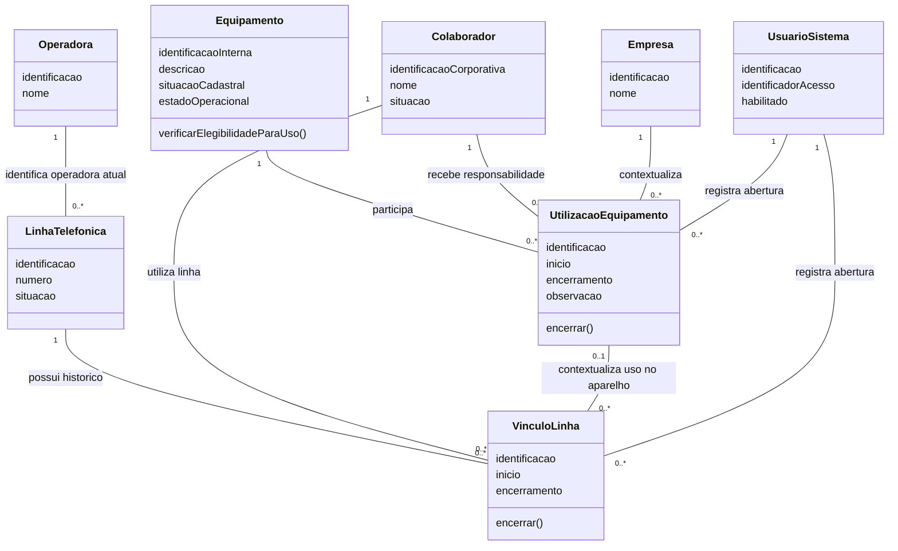
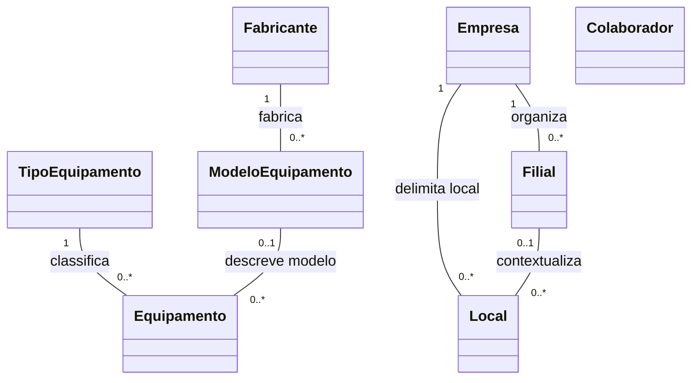
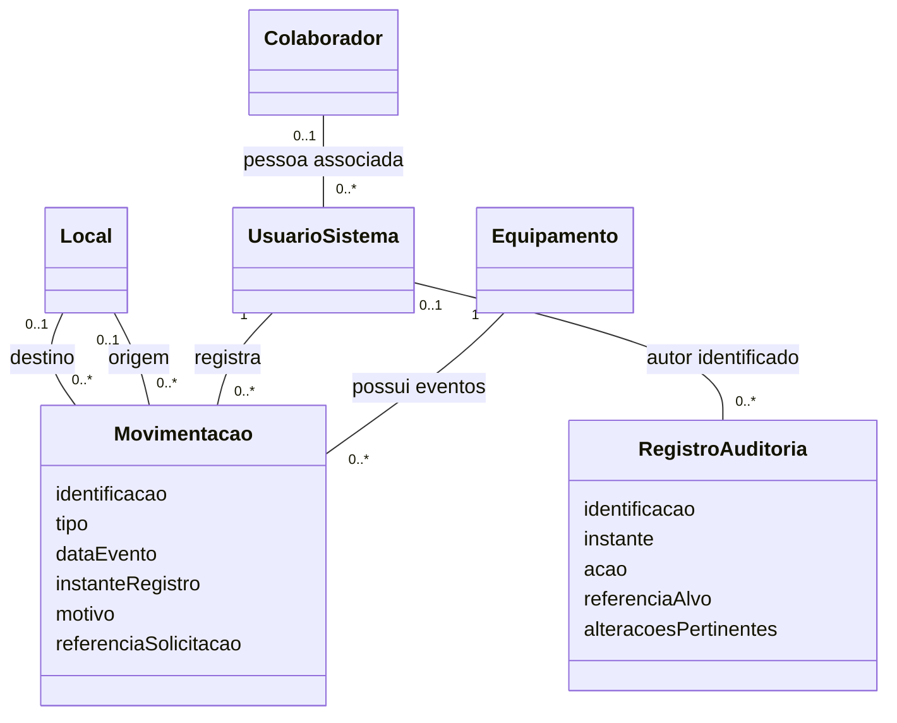

# 07 — Diagrama de classes

## 1. Identificação e objetivo

| Campo      | Registro                                                     |
| ---------- | ------------------------------------------------------------ |
| Projeto    | Sistema de Controle de Ativos de TI                          |
| Versão    | 0.1 — modelo de análise candidato                          |
| Data       | 20/10/2026                                                   |
| Situação | Proposto; sujeito à validação das regras e cardinalidades |

Representar os conceitos necessários aos três controles principais — Cadastro de Equipamentos, Cadastro de Linhas Telefônicas e Utilização de Equipamentos — e suas relações com organização, movimentações e usuários.

O modelo é de análise do domínio. Não define tabelas, chaves estrangeiras, classes PHP, endpoints ou estrutura final da aplicação. Campos e operações são candidatos; não representam funcionalidades implementadas.

### Fontes

- [Contexto central](../../CONTEXTO_SISTEMA_CONTROLE_ATIVOS_TI.md).
- [Escopo 0.3](../01-escopo-e-proposta/01-escopo-e-proposta.md).
- [Requisitos 0.1](../03-analise-e-especificacao-de-requisitos/03-analise-e-especificacao-de-requisitos.md).
- [Modelagem UML 0.1](../04-modelagem-uml/04-modelagem-uml.md).
- [Casos de uso 0.1](../05-diagrama-e-especificacao-de-casos-de-uso/05-diagrama-e-especificacao-de-casos-de-uso.md).
- [Matriz de rastreabilidade 0.1](../06-matriz-de-rastreabilidade/06-matriz-de-rastreabilidade.md).

Q, RF, UC, RN-P e RNF remetem aos catálogos existentes. As divergências D01–D08 da matriz permanecem registradas: incluir telefonia nesta visão acompanha o escopo atual, sem aprovar automaticamente sua prioridade de implementação.

## 2. Convenções de leitura

- Uma classe representa conceito, estado ou responsabilidade do domínio.
- Atributos indicam informações a investigar; ausência de tipo ou de campo não implica definição final.
- Operações representam comportamentos candidatos, não assinaturas técnicas prontas.
- `1`, `0..1` e `0..*` expressam multiplicidades por associação, conforme as hipóteses abaixo.
- Multiplicidade histórica não define quantos vínculos podem coexistir no mesmo instante.
- As três visões são recortes do mesmo modelo: classes repetidas representam o mesmo conceito.

São fontes textuais Mermaid. Não foram renderizadas nem exportadas para PNG/SVG nesta entrega.

## 3. Hipóteses explícitas do modelo

Os códigos HC são locais desta etapa e não substituem H01–H04 da etapa 04.

| ID   | Hipótese adotada para desenhar                                                                                   | Limite e decisão pendente                                                                             |
| ---- | ----------------------------------------------------------------------------------------------------------------- | ------------------------------------------------------------------------------------------------------ |
| HC01 | Cada UtilizacaoEquipamento referencia um equipamento; cada equipamento admite vários vínculos ao longo do tempo | Mantém H01; simultaneidade depende de RN-P03/Q07                                                      |
| HC02 | A utilização do recorte referencia um colaborador e uma empresa                                                 | Mantém H02; entrega apenas à unidade, sem pessoa, exige refinamento de destinatário; Q02/Q07        |
| HC03 | Linha possui vínculos temporais próprios, representados por VinculoLinha                                        | Permite mudança sem sobrescrever história; cardinalidades simultâneas e uso independente exigem Q10 |
| HC04 | Cada VinculoLinha referencia uma linha e um colaborador; pode se relacionar a uma utilização de equipamento     | Recorte proposto, não cobre ainda linha destinada só à unidade; Q10                                 |
| HC05 | Cada Movimentacao registra um ativo individual e um usuário autor                                                | Mantém H03; eventos em lote exigem agrupamento; dados legados sem autor exigem tratamento explícito  |
| HC06 | Filial pertence a uma empresa; local do recorte pertence a uma empresa e pode pertencer a uma filial              | Organização real, consistência entre empresa/filial/local e histórico exigem Q02/Q05               |
| HC07 | Um UsuárioSistema pode ter ligação com um colaborador, mas ela não é obrigatória                            | Quantidade de contas por pessoa e contas técnicas dependem de Q01                                     |
| HC08 | Utilizações e vínculos de linha possuem usuário responsável pelo registro                                    | Não confundir autor do lançamento com destinatário do ativo; Q01/Q11                                |

Essas hipóteses tornam o desenho discutível e verificável. Não são decisões empresariais confirmadas. A separação de VinculoLinha é uma proposta de modelagem motivada pelo histórico, não evidência de tela ou estrutura já existente.

## 4. Visão central — equipamento, linha e utilização

### Interpretação das associações

Cada equipamento pode acumular várias utilizações, e cada colaborador pode acumular vários equipamentos ao longo do tempo. Isso não autoriza sobreposição incompatível para a mesma unidade. As datas de início e encerramento precisam ser avaliadas em conjunto com as regras de entrega e devolução.

Cada linha pode acumular vínculos temporais. Um vínculo pode estar associado a uma utilização do equipamento ou existir sem ela, conforme o recorte HC04. A associação `0..*` permite registrar trocas de linha durante um período de utilização; não aprova várias linhas simultâneas. A cardinalidade temporal e a política de mudança serão validadas em Q10.

A referência da linha à operadora mostra somente o vínculo atual do recorte. Se for necessário acompanhar portabilidade ou histórico de operadora, deverá ser modelado um relacionamento temporal próprio. Não usar a associação atual para reconstruir informação passada sem política de preservação.

O autor da abertura identifica quem efetuou o lançamento. Encerramentos e alterações podem ser executados por outro usuário e precisam de auditoria própria. O atributo “responsável pelo ativo” não deve substituir a identidade de quem registrou a operação.

### Por que separar equipamento e linha?

O aparelho é um ativo físico e a linha é um recurso de telefonia. Podem ser cadastrados e acompanhados separadamente. Um equipamento sem telefonia não precisa receber uma linha fictícia. Uma troca de aparelho ou de linha deve preservar os vínculos anteriores.

## 5. Visão de classificação e organização

### Limites deste recorte

- Tipo obrigatório e modelo opcional são hipóteses do cadastro candidato; obrigatoriedade deve ser validada em Q03.
- Cada modelo referencia um fabricante neste recorte. Fabricante para equipamento sem modelo e associação tipo–modelo não estão resolvidos.
- Local pode representar depósito, setor ou outro espaço pertinente. Não equivale automaticamente a filial.
- A organização do colaborador e a localização atual do equipamento dependem de regras de temporalidade; não foram fixadas como campos/associações finais neste recorte.
- Não foram definidas relações de propriedade jurídica do ativo ou transferência entre empresas.

A Empresa contextualizada numa utilização não deve ser inferida pela empresa atual do colaborador caso este tenha mudado de vínculo. A necessidade de preservar a informação da época precisa orientar a modelagem histórica.

## 6. Visão de eventos e autoria

### Eventos de negócio e auditoria

Movimentacao registra o que ocorreu no ciclo do equipamento: entrada, saída, devolução, transferência ou outro evento aprovado. RegistroAuditoria registra a ação realizada na aplicação, como alteração cadastral ou correção. Um conceito não substitui o outro.

A autoria opcional da auditoria considera tentativas antes da autenticação ou ações técnicas ainda a definir. Não permite deixar sem autor uma movimentação confirmada por operador autenticado. Contas técnicas e importações legadas dependem de política explícita; não atribuir falsamente dados antigos ao usuário que apenas importou o arquivo.

Origem e destino são opcionais no modelo geral porque nem todo tipo de evento usa ambos. Regras por tipo podem torná-los obrigatórios, como destino numa saída. `0..1` não dispensa validação da operação.

Data do evento pode ser diferente do instante de registro quando lançamento retroativo for autorizado. Ordenação, correção de períodos e efeito na posição histórica precisam ser definidos em Q06/Q11.

### Eventos em lote, entrada e correção

Um recebimento de várias unidades pode agrupar eventos individuais. Uma classe de operação/lote poderá ser necessária, mas campos, vínculo e atomicidade dependem de Q05/Q14. Por isso o desenho não fixa Recebimento como composição de equipamentos nem impõe um recebimento único por ativo durante toda sua vida.

Correção deve referenciar o registro original e manter rastreabilidade. Definir se será estorno, ajuste ou outra operação antes de fixar associações de correção e seus efeitos. Movimentações não podem ser substituídas silenciosamente para alterar saldo.

## 7. Responsabilidades e atributos candidatos

| Classe/conceito              | Responsabilidade                               | Informações a detalhar                                   | Limite                                                                           |
| ---------------------------- | ---------------------------------------------- | ---------------------------------------------------------- | -------------------------------------------------------------------------------- |
| Equipamento                  | Identificar a unidade e representar seu estado | Tipo, modelo, identificadores aplicáveis, situação      | IMEI, serial, service tag e hostname não são obrigatórios para todos os tipos |
| TipoEquipamento              | Classificar categorias de ativo                | Identificação e nome                                     | Não define sozinho todos os comportamentos                                      |
| ModeloEquipamento/Fabricante | Padronizar descrição de produto              | Identificação, nome e relação                          | Relações e obrigatoriedade em Q03                                              |
| Empresa/Filial/Local         | Organizar contexto e localização             | Identificação, descrição e vínculos                   | Histórico organizacional em Q02/Q05                                             |
| Colaborador                  | Identificar destinatário/responsável         | Identificador corporativo, nome e situação               | Conta de acesso não é obrigatória por receber equipamento                     |
| UtilizacaoEquipamento        | Manter período de uso de uma unidade          | Início, encerramento, empresa, pessoa e observação      | Não usar só “responsável atual” no equipamento para substituir história    |
| LinhaTelefonica/Operadora    | Identificar linha e serviço                   | Número, situação e operadora                            | Portabilidade e unicidade em Q10                                                 |
| VinculoLinha                 | Preservar períodos de associação de linha   | Início, encerramento e contexto                           | Cardinalidade simultânea ainda pendente                                         |
| Movimentacao                 | Representar evento do ativo                    | Tipo, data, origem, destino, motivo, autoria e referência | Não é um saldo editável                                                       |
| UsuarioSistema               | Representar identidade de acesso               | Identificador de acesso e habilitação                    | Política de credenciais e sessões na arquitetura                               |
| RegistroAuditoria            | Rastrear ações relevantes                    | Autor, instante, alvo e alterações permitidas            | Não incluir senha ou segredo em valores anteriores/novos                        |

Os atributos apresentados não têm validação final de tipo, tamanho, domínio ou nulidade. Essa decisão pertence ao refinamento de requisitos e ao modelo de dados. Identificação conceitual não é automaticamente chave primária física.

## 8. Comportamentos e coordenação das operações

Operações candidatas `encerrar()` expressam mudança de período em um vínculo. Não descrevem sozinhas todo o processo de devolução, que também envolve condição, destino, movimentação e auditoria.

A verificação de elegibilidade do Equipamento não substitui autorização ou proteção contra concorrência. Uma leitura de “disponível” seguida de gravação sem proteção não garante RNF05.

A coordenação de recebimento, saída, utilização e devolução deverá ser detalhada nas sequências e na arquitetura. Um componente de aplicação poderá coordenar vários conceitos em uma confirmação consistente, mas nenhum serviço PHP foi definido aqui.

Cadastrar equipamento não equivale a registrar sua entrada. Registrar saída não implica automaticamente iniciar utilização: o marco entre expedição, entrega e uso continua Q07/H04. Consulta de saldo deverá conciliar os eventos válidos com a condição do ativo, conforme RN-P01.

## 9. Classes complementares e relações ainda abertas

| Conceito candidato             | Motivo                                 | Refinamento necessário                                    |
| ------------------------------ | -------------------------------------- | ---------------------------------------------------------- |
| Termo/EmissaoTermo             | RF22–RF23: documento da utilização  | Modelo, versões, armazenamento e política histórica Q12 |
| Perfil/Permissao               | RF02 e RNF01: autorização            | Papéis, abrangência e associação a usuários Q01       |
| Recebimento/OperacaoLote       | RF08: chegada de várias unidades      | Cadastro parcial, agrupamento e confirmação Q05          |
| LoteImportacao/Correspondencia | RF25: origem e conciliação do legado | Formato, idempotência e limite de confirmação Q14       |
| ReferenciaSolicitacao          | RF19: origem da demanda                | Campo simples ou conceito próprio; Q10                    |
| Correcao/Estorno               | RF21: preservar original e efeitos     | Modalidades e restrições temporais Q11                   |

Não foram incluídas no desenho principal para evitar fechar multiplicidades e identidades ainda sem decisão. O catálogo registra a cobertura necessária e a lacuna de modelagem, sem fingir que todos os RFs estão resolvidos pelo diagrama.

## 10. Generalização, composição e classe versus tabela

Não foram criadas subclasses Computador e EquipamentoMovel nesta versão. Dados específicos podem ser representados por especialização, composição de características ou outra solução após Q03. A escolha deve refletir identidade e comportamento, não apenas a aparência das telas.

Administrador, gestor e operador são papéis de acesso candidatos, não subclasses obrigatórias de Colaborador. UsuarioSistema e Colaborador são conceitos distintos associados, não uma hierarquia de herança.

As associações desenhadas são simples. Não foram usados losangos de composição para sugerir apagamento de vínculos ao remover cadastro. UML não define política de exclusão SQL; histórico e retenção deverão ser tratados explicitamente.

Uma classe pode resultar em uma ou mais estruturas de persistência, e uma associação pode exigir outra representação relacional. DER, chaves, normalização e restrições físicas serão detalhados na etapa 12 após validar o domínio.

## 11. Rastreabilidade dos recortes

| Área                | Classes/conceitos                                                    | Requisitos/casos                            | Pendências                     |
| -------------------- | -------------------------------------------------------------------- | ------------------------------------------- | ------------------------------- |
| Equipamentos         | Equipamento, TipoEquipamento, ModeloEquipamento, Fabricante          | RF05–RF07; UC05–UC07                      | Q03/Q04                         |
| Telefonia            | LinhaTelefonica, Operadora, VinculoLinha                             | RF18; UC18                                  | Q10; revisão de prioridade D01 |
| Utilização         | UtilizacaoEquipamento, Colaborador, Empresa, UsuarioSistema          | RF04, RF12–RF14; UCs correspondentes       | Q02/Q07/Q08                     |
| Organização        | Empresa, Filial, Local                                               | RF03, RF08–RF09; UCs correspondentes       | Q02/Q05                         |
| Movimentação       | Equipamento, Movimentacao, Local, UsuarioSistema                     | RF08, RF11, RF14–RF17; UCs correspondentes | Q05/Q07–Q09                    |
| Histórico e autoria | UtilizacaoEquipamento, VinculoLinha, Movimentacao, RegistroAuditoria | RF10, RF13, RF20–RF21                      | Q06/Q11                         |
| Acesso               | UsuarioSistema e conceitos de permissões a refinar                  | RF01–RF02; RNF01/RNF03                     | Q01                             |
| Complementos         | Termo, lote e referências ainda não detalhados                     | RF19, RF22–RF25                            | Q10/Q12–Q14                    |

Relatórios de RF24 são consultas sobre o domínio; não exigem classe persistente “Relatorio” apenas porque existe a funcionalidade. RNF07–RNF12 também exigem decisões técnicas e operacionais que este modelo conceitual não comprova.

## 12. Cenários para revisar as multiplicidades

1. **Equipamento sem utilização:** uma unidade recém-recebida existe e pode estar em estoque, com zero utilizações.
2. **Reutilização do ativo:** um notebook é entregue, devolvido e entregue a outra pessoa; duas utilizações históricas distintas permanecem ligadas à mesma unidade.
3. **Usuário e destinatário distintos:** operador registra entrega para outro colaborador; o modelo identifica os dois papéis separadamente.
4. **Celular com linha:** utilização do aparelho pode contextualizar vínculo de linha, sem fundir seus cadastros.
5. **Troca de linha durante o uso:** encerrar vínculo anterior e registrar novo período, conforme regra; não apagar a associação anterior.
6. **Linha sem aparelho:** o recorte permite vínculo sem utilização de equipamento; confirmar se o processo real aceita esse cenário.
7. **Destino somente unidade:** HC02/HC04 ainda não cobrem destinatário sem pessoa; resolver antes de tratar como cenário aprovado.
8. **Transferência:** mudança de local não cria novo ativo; o tratamento do responsável depende da modalidade aprovada.
9. **Devolução danificada:** encerrar vínculo conforme regra e registrar condição/destino, sem presumir retorno ao disponível.
10. **Inativação posterior:** consulta histórica permanece possível; o estado atual não substitui as condições da época.

São roteiros de validação, não testes executados. Erros ou contradições identificados devem atualizar requisitos, casos e matriz, preservando seus IDs.

## 13. Checklist de validação e histórico

- [ ] Validar HC01–HC08 com exemplos do processo empresarial.
- [ ] Resolver destino loja/unidade sem colaborador antes de fechar destinatários.
- [ ] Aprovar cardinalidades simultâneas de equipamentos e linhas, separadas das históricas.
- [ ] Definir organização e temporalidade de empresa, filial, local e colaborador.
- [ ] Definir recebimento, lote e origem de entrada sem duplicar quantidade.
- [ ] Refinar identificação por tipo de equipamento.
- [ ] Definir correção, auditoria e autoria de importações sem atribuições falsas.
- [ ] Definir política de documento histórico e permissões em seus modelos próprios.
- [ ] Renderizar os diagramas e revisar legibilidade e semântica.
- [ ] Atualizar a matriz de rastreabilidade quando os vínculos forem aprovados.

| Versão | Data       | Registro                                                                                                                                                             |
| ------- | ---------- | -------------------------------------------------------------------------------------------------------------------------------------------------------------------- |
| 0.1     | 20/10/2026 | Três recortes de classes conceituais, atributos/operações candidatos, multiplicidades justificadas por hipóteses, rastreabilidade e lacunas; sem implementação |

Próxima etapa prevista: diagramas de sequência. As sequências deverão usar estes conceitos como candidatos, refinando as responsabilidades sem transformar hipóteses em arquitetura aprovada.
